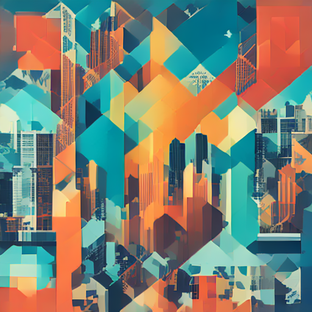

# Лабораторная работа №5

## Запуск открытой модели text-to-image

**Дисциплина:** «Искусственный интеллект в креативных технологиях»  
**Вариант:** 7  
**Бриф:** №2 — обложка подкаста о городской среде  
**Условие:** `repeat` — повтор запуска в том же сеансе  
**Студент:** Провков Иван Александрович  
**Группа:** Т26ИИКТ-МИК11  
**Дата выполнения:** 21.10.2026

---

## 1. Цель, вариант, бриф и условие

Цель работы — запустить открытую text-to-image модель по закреплённой ревизии, сохранить изображение с манифестом условий запуска и измеримо проверить воспроизводимость повторного запуска в одной сессии.

Вариант 7 сочетает бриф №2 и условие `repeat`. Нужно получить два изображения A и B со свежим CPU `Generator` для каждого вызова и одним seed 1007, затем сравнить SHA-256, пиксели и PSNR. Дополнительно требуется визуально проверить, что слои силуэта города читаются как отдельные полосы.

## 2. Гипотеза и допуск

Гипотеза и допуск были записаны **до запуска**, 20.10.2026 в 19:30.

> При неизменной среде, одинаковом prompt, seed 1007 и свежем CPU `Generator` для каждого вызова A и B совпадут побитово.

Классификация по заранее выбранному допуску:

- `identical` — побитовое равенство пикселей;
- `close` — пиксели различаются, но PSNR ≥ 40 dB;
- `different` — PSNR < 40 dB.

## 3. Данные, prompt, модель, лицензия и ограничения

Использован синтетический prompt из `lab05_lib.py`:

> square podcast cover about the city environment, abstract layered skyline of geometric shapes, teal and orange palette, minimal flat style, no text, no people

Модель: `stabilityai/sd-turbo`. Ревизия: `b261bac6fd2cf515557d5d0707481eafa0485ec2`. Параметры: 1 шаг, `guidance_scale = 0.0`, 512×512, `float16`, CPU `Generator`.

Модель распространяется по [Stability AI Community License Agreement](https://huggingface.co/stabilityai/sd-turbo/blob/b261bac6fd2cf515557d5d0707481eafa0485ec2/LICENSE.md). Запуск выполнен в учебных некоммерческих целях и должен соответствовать [Stability AI Acceptable Use Policy](https://stability.ai/use-policy). За рамками этого отчёта юридические выводы о других сценариях использования не делаются.

Ограничения брифа: не изображать узнаваемых людей и реальные здания с товарными знаками; не выдавать синтетический образ за фотографию города.

## 4. Рабочая среда

| Параметр | Фактическое значение |
| --- | --- |
| Среда | Google Colab |
| GPU | Tesla T4 |
| Python | `3.13.15` |
| torch | `2.11.0+cu130` |
| diffusers | `0.41.0` |
| transformers | `5.20.1` |
| Pillow | `11.3.0` |
| Platform | `Linux-6.6.122+-x86_64-with-glibc2.39` |
| CUDA available | `True` |

Времена фактического запуска: загрузка модели — 26.77 s, прогрев — 5.62 s, baseline — 0.36 s, пара A/B — 0.66 s. Полная фиксация среды сохранена в [environment.txt](environment.txt).

## 5. Ход работы

Ниже приведены фрагменты из фактически выполненного notebook без изменения кода.

Загрузка pipeline и прогрев:

```python
# Загрузка закреплённой ревизии и прогрев.
load_started = time.perf_counter()
pipe = L.load_pipe()
load_seconds = time.perf_counter() - load_started

warmup_started = time.perf_counter()
_ = L.generate(pipe, PROMPT, 1)[0]
warmup_seconds = time.perf_counter() - warmup_started
print({"load_seconds": round(load_seconds, 2), "warmup_seconds": round(warmup_seconds, 2)})
```

Базовая генерация:

```python
# Базовый запуск: artifacts/run_001/result.png и manifest.json.
generation_started = time.perf_counter()
baseline = L.generate(pipe, PROMPT, SEED, STEPS, GUIDANCE, SIZE)[0]
generation_seconds = time.perf_counter() - generation_started
baseline_bytes = L.png_bytes(baseline)
baseline_sha256 = L.sha(baseline_bytes)
(artifacts / "run_001" / "result.png").write_bytes(baseline_bytes)
```

Пара A/B со свежими CPU-генераторами создаётся функцией `L.make_pair`; внутри `L.generate` для каждого вызова создаётся новый `Generator`:

```python
gens = [torch.Generator(device=gen_device).manual_seed(seed + i) for i in range(batch)]

# Пара A/B для repeat: каждый вызов L.generate создаёт свежий CPU-Generator.
pair_started = time.perf_counter()
image_a, image_b = L.make_pair(pipe, PROMPT, SEED, CONDITION)
pair_seconds = time.perf_counter() - pair_started

library_summary = L.variant_summary(pipe, VARIANT)
```

Намеренная ошибка — один общий `Generator` для двух последовательных вызовов:

```python
# Намеренная ошибка: один общий Generator на два вызова. Рабочая реализация не изменяется.
shared_generator = torch.Generator(device="cpu").manual_seed(SEED)
error_image_1 = pipe(
    prompt=PROMPT, num_inference_steps=STEPS, guidance_scale=GUIDANCE,
    height=SIZE, width=SIZE, generator=shared_generator).images[0]
error_image_2 = pipe(
    prompt=PROMPT, num_inference_steps=STEPS, guidance_scale=GUIDANCE,
    height=SIZE, width=SIZE, generator=shared_generator).images[0]
```

## 6. Результаты

### 6.1. Baseline manifest

| Поле | Фактическое значение |
| --- | --- |
| `model_id` | `stabilityai/sd-turbo` |
| `revision` | `b261bac6fd2cf515557d5d0707481eafa0485ec2` |
| `prompt` | `square podcast cover about the city environment, abstract layered skyline of geometric shapes, teal and orange palette, minimal flat style, no text, no people` |
| `seed` | `1007` |
| `steps` | `1` |
| `guidance_scale` | `0.0` |
| `size` | `512` |
| `generator_device` | `cpu` |
| `dtype` | `float16` |
| GPU | `Tesla T4` |
| Python | `3.13.15` |
| Пакеты | torch `2.11.0+cu130`; diffusers `0.41.0`; transformers `5.20.1`; Pillow `11.3.0` |
| SHA-256 | `96b809ceb59215db2a042f58ec1bdf68d336f5b6797a415f70790495fadb6efb` |

### 6.2. Baseline image



### 6.3. Сравнение A/B

| Показатель | A | B / итог |
| --- | --- | --- |
| SHA-256 | `96b809ceb59215db2a042f58ec1bdf68d336f5b6797a415f70790495fadb6efb` | `96b809ceb59215db2a042f58ec1bdf68d336f5b6797a415f70790495fadb6efb` |
| `pixel_equal` | — | `true` |
| `max_diff` | — | `0` |
| PSNR | — | `inf` |
| `verdict` | — | `identical` |
| `visual_check` | — | `true` |

| A | B |
| --- | --- |
|  |  |

Файлы A и B имеют формат PNG, размер 512×512 и режим RGB. Визуальная проверка пройдена: слои силуэта города читаются как отдельные полосы.

## 7. Анализ совпадения и намеренной ошибки

Пара A/B совпала побитово: SHA-256 одинаковы, `pixel_equal = true`, `max_diff = 0`, PSNR = `inf`, `verdict = identical`. Гипотеза подтверждена **в пределах текущей зафиксированной Colab-сессии**.

В намеренной ошибке первый SHA-256 равен `96b809ceb59215db2a042f58ec1bdf68d336f5b6797a415f70790495fadb6efb`, второй — `2c1de397892ed86b7ae10074c54b73f745c2a5e455f918fafe13349c159b55cd`; `pixel_equal = false`, `max_diff = 255`, PSNR = 9.035864314461799 dB. Повторное использование одного объекта `Generator` изменило второй результат, потому что состояние генератора продвинулось после первого вызова; в JSON диагноз записан как `Generator state advances after the first call`. Исправление — создавать новый `torch.Generator(device="cpu").manual_seed(seed)` для каждого вызова.

## 8. Угрозы валидности

- Проверен один seed.
- Проверена одна конфигурация.
- Эксперимент выполнен в одной Colab-сессии.
- Другой GPU может изменить результат.
- Другие версии torch, diffusers, transformers и CUDA могут изменить результат.
- Другая платформа может изменить результат.
- Совпадение внутри одного сеанса не доказывает совпадение на другой машине.
- SHA-256 и PSNR не оценивают художественное качество.
- Визуальная проверка соответствия брифу содержит человеческую оценку.

## 9. Паспорт эксперимента и ссылки на артефакты

- [Notebook с outputs](../lab05.ipynb)
- [Базовое изображение](../artifacts/run_001/result.png)
- [Базовый manifest](../artifacts/run_001/manifest.json)
- [Сравнение A/B](../artifacts/comparison.json)
- [Намеренная ошибка](../artifacts/intentional_error.json)
- [Паспорт эксперимента](../artifacts/passport.json)
- [Зафиксированная среда](environment.txt)
- [Подготовка к защите](defense.md)

Корень репозитория: [github.com/oneway192/ai-in-ci](https://github.com/oneway192/ai-in-ci).

## 10. Итоговый вывод

Гипотеза подтверждена **в пределах текущей зафиксированной Colab-сессии**.

При одинаковом prompt, seed 1007 и свежем CPU `Generator` для каждого запуска изображения A и B совпали побитово: SHA-256 одинаковы, `pixel_equal = true`, `max_diff = 0`, PSNR = `inf`, `verdict = identical`.

Это не доказывает воспроизводимость на другой машине, на другом GPU, при других версиях библиотек или на другой платформе.

В намеренной ошибке повторное использование одного объекта `Generator` изменило второй результат, потому что состояние генератора продвинулось после первого вызова.

Статус работы: **PASS**.

## 11. Индивидуальный вклад

Студент подготовил и выполнил notebook в Google Colab, зафиксировал среду и гипотезу, выполнил вариант 7, провёл визуальную проверку, сохранил фактические артефакты и проанализировал воспроизводимость и намеренную ошибку.

## 12. Приложение A. Manifest базового запуска

Ниже приведено фактическое содержимое `LR05/artifacts/run_001/manifest.json` без изменения значений.

```json
{
  "model_id": "stabilityai/sd-turbo",
  "revision": "b261bac6fd2cf515557d5d0707481eafa0485ec2",
  "prompt": "square podcast cover about the city environment, abstract layered skyline of geometric shapes, teal and orange palette, minimal flat style, no text, no people",
  "variant": 7,
  "brief": 2,
  "condition": "repeat",
  "seed": 1007,
  "steps": 1,
  "guidance_scale": 0.0,
  "size": 512,
  "generator_device": "cpu",
  "dtype": "float16",
  "device": "Tesla T4",
  "platform": "Linux-6.6.122+-x86_64-with-glibc2.39",
  "python": "3.13.15",
  "packages": {
    "torch": "2.11.0+cu130",
    "diffusers": "0.41.0",
    "transformers": "5.20.1",
    "pillow": "11.3.0"
  },
  "load_seconds": 26.77,
  "warmup_seconds": 5.62,
  "generation_seconds": 0.36,
  "image_size": [
    512,
    512
  ],
  "image_mode": "RGB",
  "sha256": "96b809ceb59215db2a042f58ec1bdf68d336f5b6797a415f70790495fadb6efb",
  "library_sha256": "4eb176506585ffcda1702605a767309fb451808229c3622f80ce882b7fa2ce1a",
  "executed_at_utc": "2026-10-21T16:57:28.517968+00:00"
}
```
