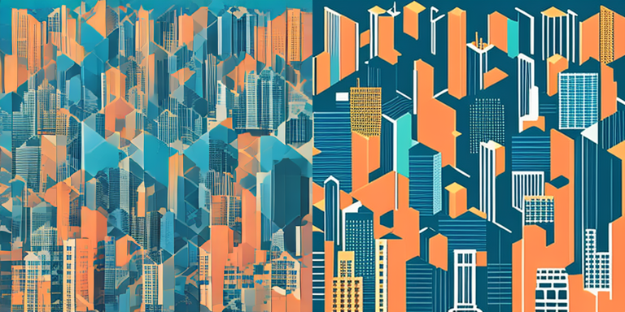
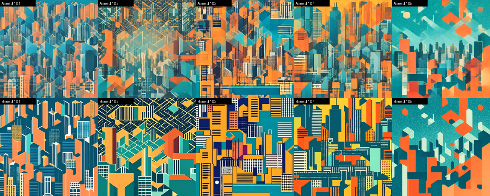

# Лабораторная работа №6

## Исследование параметров text-to-image генерации

**Дисциплина:** «Искусственный интеллект в креативных технологиях»  
**Вариант:** 7  
**Бриф:** №2 — обложка подкаста о городской среде  
**Фактор:** №1 — число шагов, 1 → 4  
**Студент:** Провков Иван Александрович  
**Группа:** Т26ИИКТ-МИК11  
**Дата выполнения:** 27.10.2026

---

## 1. Цель, бриф, фактор, гипотеза и допуск

Цель работы — превратить подбор параметров генерации в контролируемый эксперимент: изменить один фактор, сохранить остальные условия, измерить отклик по нескольким метрикам на серии seed и сделать вывод в пределах проверенных условий.

Вариант 7 = (2 − 1) · 6 + 1: бриф 2 × фактор 1. Сравниваются два режима на одних и тех же seed 101…105:

| | Режим A | Режим B |
| --- | --- | --- |
| Запрос | структурированный английский бриф `BRIEFS[1]` | тот же |
| Число шагов | **1** | **4** |
| `guidance_scale` | 0.0 | 0.0 |
| Размер | 512×512 | 512×512 |
| Тип вычислений, генератор | `float16`, CPU `Generator` | те же |

Задача варианта — определить, как четыре шага вместо одного меняют детализацию, контраст, сходство с брифом и время, окупается ли рост времени по допуску, и глазами проверить, что слои силуэта города читаются как отдельные полосы.

### Гипотеза и допуск

Гипотеза и допуск записаны **до запуска**, 27.10.2026 в 18:10 ([журнал](journal.md)).

> Переход с 1 на 4 шага для брифа 2 увеличит энергию границ и контраст больше чем на 10 %, а время генерации — больше чем на 20 %. Сходство CLIP с английским брифом изменится в пределах ±1,0, потому что SD Turbo обучена давать удовлетворительный результат за один шаг.

| Метрика | Допуск | Обоснование |
| --- | --- | --- |
| Сходство CLIP | ±1,0 (абсолютное) | в демо-варианте методички разброс между seed `s ≈ 1,4`; изменение меньше 1 пункта не считается практически значимым для подбора параметров |
| Энергия границ | ±10 % от A | меньшее изменение детализации на обложке, уменьшенной до 384 px, визуально почти не различимо |
| Контраст | ±10 % от A | тот же порог, что для энергии границ: обе метрики считаются по яркости |
| Время, с | ±20 % от A | в демо время режима A между сеансами колебалось от 0,29 до 0,35 с (~20 %); меньшие изменения не отделить от состояния GPU |

Направления заданы заранее, исходя из брифа: рост CLIP и контраста — «улучшение» (слои силуэта должны читаться как полосы); рост энергии границ — «ухудшение» (бриф требует minimal flat style, лишняя мелкая текстура ему противоречит); рост времени — «ухудшение». Изменение внутри допуска — «нейтрально».

**Правило решения:** 4 шага окупаются, если CLIP даёт «улучшение» либо на B слои силуэта читаются как полосы, а на A — нет, и при этом CLIP не даёт «ухудшение». Энергия границ и контраст сами по себе решение не определяют.

## 2. Данные, модели, лицензии и ограничения

Данные синтетические — тексты запросов из `lab05_lib.py`. Реальные лица, логотипы и материалы с неподтверждёнными правами не используются.

Запрос обоих режимов и эталон для CLIP:

> square podcast cover about the city environment, abstract layered skyline of geometric shapes, teal and orange palette, minimal flat style, no text, no people

| Модель | Назначение | Лицензия |
| --- | --- | --- |
| `stabilityai/sd-turbo` | генерация | [Stability AI Community License Agreement](https://huggingface.co/stabilityai/sd-turbo/blob/b261bac6fd2cf515557d5d0707481eafa0485ec2/LICENSE.md) |
| `openai/clip-vit-base-patch32` | метрика сходства | в метаданных карточки на закреплённой ревизии лицензия не указана; исходный код CLIP ([openai/CLIP](https://github.com/openai/CLIP)) распространяется по MIT |

Закреплённые ревизии обеих моделей приведены в разделе 3.

Работа выполнена в учебных некоммерческих целях в соответствии со [Stability AI Acceptable Use Policy](https://stability.ai/use-policy). CLIP используется только для измерения, его выходы не распространяются. Юридических выводов о других сценариях использования отчёт не делает.

Ограничения брифа: не изображать узнаваемых людей и реальные здания с товарными знаками; не выдавать синтетический образ за фотографию города.

## 3. Рабочая среда

| Параметр | Фактическое значение |
| --- | --- |
| Среда | Google Colab |
| GPU | Tesla T4, CUDA runtime 13.0 |
| Python | `3.13.16` |
| torch | `2.11.0+cu130` |
| diffusers | `0.41.0` |
| transformers | `5.20.2` |
| Pillow / numpy / scipy | `11.3.0` / `2.1.3` / `1.16.3` |
| Platform | `Linux-6.6.159+-x86_64-with-glibc2.39` |
| Исправление среды | `torchao` удалён до импорта `diffusers` |
| Ревизия SD Turbo | `b261bac6fd2cf515557d5d0707481eafa0485ec2` |
| Ревизия CLIP | `3d74acf9a28c67741b2f4f2ea7635f0aaf6f0268` |

Версии отличаются от проверенных в методичке (diffusers 0.40.0, transformers 5.16.1, cu128). Полная фиксация — в [environment.txt](environment.txt).

**Ошибка среды.** При первом запуске импорт `diffusers` упал: `ImportError: cannot import name 'FqnToConfig' from 'torchao.quantization'`. Предустановленный в Colab `torchao` оказался несовместим с `diffusers`. SD Turbo и CLIP `torchao` не используют, поэтому первой ячейкой ноутбука пакет удаляется, затем сеанс перезапускается. Лог: [torchao_import_error.log](torchao_import_error.log).

## 4. Ход работы

Ноутбук [lab06.ipynb](../lab06.ipynb) выполнен в Colab сверху вниз. Ниже — фрагменты кода из него без изменений.

1. Ячейки `%%writefile` записывают `lab05_lib.py`, `lab06_lib.py` и `lab06_demo.py`; их SHA-256 сверяются с методичкой (`4eb17650…`, `c6d8473c…`, `6bd455ea…`) до загрузки моделей.
2. Проверяется, что режимы различаются ровно одним полем:

```python
PROMPT = L.BRIEFS[c]
A_CFG, B_CFG = M.settings(FACTOR, c)
changed = sorted(key for key in A_CFG if A_CFG[key] != B_CFG[key])
assert changed == ["steps"], changed
```

3. Демонстрационный вариант 1 выполняется без изменений командой `%run lab06_demo.py` и сверяется с таблицей 6.3 методички.
4. Модели загружаются заново, затем выполняется обязательный вызов методички:

```python
summary_started = time.perf_counter()
summary = M.variant_summary(pipe, clip, VARIANT)
summary_seconds = time.perf_counter() - summary_started
assert summary["variant"] == VARIANT and summary["ctx"] == BRIEF and summary["factor"] == FACTOR
```

5. Тем же `M.measure` значения снимаются по каждому seed; средние CLIP, энергии и контраста совпали с `variant_summary` до нуля, то есть метрики детерминированы. Строится лист всех пяти seed.
6. Сравнительный лист seed 101 строится кодом раздела 6.2 методички с `N = 7`; проверено, что он собран из тех же изображений, что и серия.
7. Классификация по допуску, записанному до запуска:

```python
def classify(metric, a, d, scale=1.0):
    kind, tol = TOLERANCE[metric]
    change = d if kind == "abs" else d / a
    if abs(change) <= tol * scale:
        return "нейтрально"
    return "улучшение" if change * DIRECTION[metric] > 0 else "ухудшение"
```

8. Визуальная проверка заполняется вручную после просмотра изображений.
9. Намеренная ошибка демо повторяется на брифе варианта:

```python
x_g0 = L.generate(pipe, PROMPT, 101, guidance=0.0)[0]; cfg_g0 = pipe.do_classifier_free_guidance
x_g1 = L.generate(pipe, PROMPT, 101, guidance=1.0)[0]; cfg_g1 = pipe.do_classifier_free_guidance
x_g3 = L.generate(pipe, PROMPT, 101, guidance=3.0)[0]; cfg_g3 = pipe.do_classifier_free_guidance
```

10. Паспорт и итоговая проверка: статус `COMPLETE`, `FULL CHECKLIST: PASS`.

Ноутбук выполнялся в одном сеансе дважды: первый прогон остановился на итоговой проверке, потому что визуальная проверка ещё не была заполнена. Во втором прогоне CLIP, энергия границ, контраст и SHA-256 всех десяти изображений совпали с первым; отличается только время. В отчёт вошёл второй прогон.

## 5. Результаты

### 5.1. Таблица метрик (seed 101…105)

| Метрика | A (1 шаг) | s | B (4 шага) | Δ | \|Δ\|/s | \|Δ\| > 2s |
| --- | ---: | ---: | ---: | ---: | ---: | :---: |
| сходство CLIP | 34.0965 | 1.8301 | 32.6521 | −1.4444 | 0.79 | нет |
| энергия границ | 0.0417 | 0.0126 | 0.0653 | +0.0237 | 1.87 | нет |
| контраст | 0.1673 | 0.0159 | 0.2463 | +0.0790 | 4.98 | да |
| время, с | 0.3290 | 0.0154 | 0.5894 | +0.2605 | 16.92 | да |

Значения по каждому seed:

| seed | CLIP A → B | энергия границ A → B | контраст A → B | время A → B, с |
| ---: | --- | --- | --- | --- |
| 101 | 35.18 → 32.61 | 0.0469 → 0.0710 | 0.161 → 0.243 | 0.367 → 0.678 |
| 102 | 31.37 → 32.47 | 0.0461 → 0.0827 | 0.162 → 0.274 | 0.485 → 0.703 |
| 103 | 34.75 → 33.50 | 0.0553 → 0.0807 | 0.195 → 0.274 | 0.335 → 0.593 |
| 104 | 33.20 → 31.97 | 0.0383 → 0.0670 | 0.162 → 0.255 | 0.320 → 0.581 |
| 105 | 35.99 → 32.70 | 0.0218 → 0.0253 | 0.156 → 0.185 | 0.325 → 0.580 |

Время в этой таблице — из второго прохода `M.measure`, поэтому оно не совпадает со средними `variant_summary`.

### 5.2. Сравнительный лист





### 5.3. Визуальное описание

- **A (1 шаг):** плотный коллаж из полупрозрачных наложенных фигур с фототекстурой окон; слои сливаются в мозаику. Полоса силуэта под небом читается только на seed 105.
- **B (4 шага):** сплошные заливки и резкие края, меньше полупрозрачности — ближе к flat style. Но здания разбросаны сеткой по всему кадру, а не лежат горизонтальными полосами; seed 102 превратился в изометрический узор. Появились цвета вне палитры брифа: жёлтый, тёмно-синий, на seed 103 фиолетовый.
- **Проверка брифа** («слои силуэта читаются как отдельные полосы»): seed 101 — нет на A и нет на B; по пяти seed — A 1 из 5 (105), B 2 из 5 (104, 105).

### 5.4. Воспроизведение демонстрационного варианта

| Метрика | A | B | Δ | 2s | Методичка (A / B / Δ) |
| --- | ---: | ---: | ---: | :---: | --- |
| CLIP | 30.7979 | 30.2920 | −0.5059 | нет | 30.796 / 30.292 / −0.504 |
| энергия границ | 0.0457 | 0.0920 | +0.0463 | да | 0.0457 / 0.0920 / +0.0463 |
| контраст | 0.1923 | 0.2779 | +0.0856 | да | 0.1923 / 0.2778 / +0.0855 |
| время, с | 0.3570 | 0.6253 | +0.2683 | да | 0.2854 / 0.5266 / +0.2412 |

Энергия границ совпала с методичкой на всех знаках. CLIP и контраст отличаются в третьем–четвёртом знаке (до 0.002 и 0.0001); это согласуется с другими версиями transformers и diffusers. Выводы по критерию 2s те же, что в методичке. Время отличается, потому что зависит от состояния GPU. Намеренная ошибка демо воспроизведена: при guidance 1.0 изображение совпало с 0.0 бит в бит, при 3.0 PSNR = 11.61 дБ (в методичке 11.6 дБ).

## 6. Анализ

### 6.1. Классификация по допуску

| Метрика | Изменение | Допуск | Класс | \|Δ\| > 2s | 2s и допуск согласуются |
| --- | ---: | ---: | --- | :---: | :---: |
| сходство CLIP | −1.44 | ±1.0 | **ухудшение** | нет | **нет** |
| энергия границ | +56.8 % | ±10 % | **ухудшение** | нет | **нет** |
| контраст | +47.2 % | ±10 % | **улучшение** | да | да |
| время | +79.2 % | ±20 % | **ухудшение** | да | да |

Сверка с гипотезой: энергия границ, контраст и время вышли за допуск, как и ожидалось. CLIP вместо ожидаемого «нейтрально» дал «ухудшение». Гипотеза подтверждена **частично**.

По правилу решения 4 шага **не окупаются**: CLIP дал «ухудшение», а визуальная проверка не показала, что на B слои читаются, а на A — нет (seed 101: нет на обоих).

### 6.2. Статистическая значимость и практическая польза

Для контраста и времени критерий 2s и допуск согласуются: эффект и выходит за разброс между seed, и практически заметен.

Для CLIP и энергии границ они **расходятся**: изменение больше допуска, но меньше 2s (|Δ|/s = 0,79 и 1,87). Причина — большой разброс режима A между seed: разные seed дают разные композиции. Критерий 2s сравнивает эффект с этим разбросом и не учитывает, что A и B сняты на одних и тех же seed. По парам seed картина устойчивее: энергия границ и контраст выросли на всех пяти seed, CLIP упал на четырёх из пяти (вырос только на seed 102, на +1,10). Поэтому «2s — нет» здесь означает «эффект не выходит за разброс композиций», а не «эффекта нет».

**Чувствительность к допуску.** При двукратном допуске CLIP переходит в «нейтрально» (|−1,44| < 2,0), и правило решения перестаёт давать «ухудшение». Решение «не окупается» при этом сохраняется, потому что не выполнено ни одно условие окупаемости: CLIP не улучшился, визуальная проверка B не прошла. При половинном допуске классы не меняются. Вывод о CLIP чувствителен к выбору допуска, выводы об остальных метриках — нет.

### 6.3. Наблюдение и объяснение

Наблюдения — таблицы 5.1 и 6.1 и визуальное описание 5.3. Ниже — объяснения, которые экспериментом не проверялись.

- **CLIP упал.** Возможные объяснения: в B появились цвета вне палитры «teal and orange» и композиция «сетка зданий» или изометрический узор вместо «layered skyline». Другое возможное объяснение — CLIP ViT-B/32 видит изображение уменьшенным до 224 px и сильнее реагирует на палитру и общую композицию, чем на детали. Отдельно это не проверялось.
- **Энергия границ выросла,** но визуально B ближе к flat style, чем A: рост дали резкие края сплошных заливок и сетки окон, а не шум. Правило «рост энергии = ухудшение», записанное до запуска, для этого брифа оказалось спорным. Правило не переопределялось, расхождение метрики и визуальной оценки фиксируется как ограничение метрики.
- **Контраст вырос:** в A полупрозрачные слои смешиваются в средние тона, в B — насыщенные заливки на тёмно-синем фоне.
- **Время выросло в 1,79 раза, а не в 4:** у вызова есть постоянная часть. По средним 0,329 и 0,589 с один дополнительный шаг UNet стоит около 0,087 с, а постоянная часть — около 0,24 с: кодирование текста, декодирование VAE, создание генератора. Это оценка по двум точкам, профилирование не проводилось.

### 6.4. Намеренная ошибка

**Симптом.** Ожидается, что `guidance_scale = 1.0` «включает» управление запросом и слегка меняет изображение.

**Наблюдение** (бриф 2, seed 101, 1 шаг):

| guidance | SHA-256 | `do_classifier_free_guidance` | PSNR относительно 0.0 |
| ---: | --- | :---: | ---: |
| 0.0 | `acb300686fae836078ea102ea5d9cf26bd65f83196e62db6e9df8ff5d8639889` | `False` | — |
| 1.0 | `acb300686fae836078ea102ea5d9cf26bd65f83196e62db6e9df8ff5d8639889` | `False` | ∞ |
| 3.0 | `48c9652e2de265efb91214226105b6124b458fddc2de31b02915a7cf8678866d` | `True` | 10.89 дБ |

**Диагностика.** Diffusers включает управление без классификатора только при `guidance_scale > 1`; при значениях от 0 до 1 параметр не влияет на результат. SD Turbo дистиллирована без этого механизма, поэтому рекомендованное значение 0,0.

**Исправление.** Влияние guidance у этой модели можно изучать только при значениях больше 1, то есть вне рекомендованного режима. Результат нельзя переносить на модели с обычным управлением.

### 6.5. Угрозы валидности

- Одна модель, один бриф, один фактор, пять seed.
- Эксперимент выполнен в одной сессии Colab, версии библиотек отличаются от методички, `torchao` удалён.
- Сходство CLIP — косинусное сходство ×100 в пространстве CLIP, а не оценка эстетики. Кодировщик обучен преимущественно на английском, текст усекается до 77 токенов.
- Энергия границ растёт и от чётких краёв, и от шума; контраст зависит от композиции. Обе метрики не говорят, что изображение «лучше».
- Время зависит от состояния GPU: в двух прогонах одного сеанса среднее для A было 0,281 и 0,329 с.
- Визуальную проверку выполнял один человек; признак «слои читаются как полосы» содержит субъективную оценку.
- Направления классификации для энергии границ и контраста выбраны до запуска, исходя из брифа, и сами являются допущением.

## 7. Вывод

Для брифа «обложка подкаста о городской среде» переход с 1 на 4 шага у SD Turbo:

- увеличил энергию границ на 56,8 % и контраст на 47,2 %;
- увеличил время генерации на 79,2 % (в 1,79 раза);
- снизил сходство CLIP с английским брифом на 1,44.

Энергия границ, контраст и время вышли за допуск, как ожидалось. CLIP вместо «нейтрально» дал «ухудшение», поэтому гипотеза подтверждена частично.

Статистически, по критерию 2s, значимы изменения контраста и времени. Изменения CLIP и энергии границ практически заметны по допуску, но меньше разброса между seed, хотя направление изменения устойчиво на парах seed.

Визуально 4 шага делают изображение площе и резче, но не дают слоёв силуэта, читаемых как полосы, и уводят палитру от брифа. По правилу решения, записанному до запуска, рост времени **не окупается**.

Вывод относится только к SD Turbo на закреплённой ревизии, брифу 2, seed 101…105 и зафиксированной среде Colab. Он не переносится на другие брифы, модели и версии библиотек.

**Вопрос для обсуждения.** На этих данных рекомендовать 4 шага для обложки нельзя. Для решения нужны:

- метрика соответствия палитре брифа, например расстояние гистограммы цветов до бирюзового и оранжевого;
- больше seed;
- экспертная оценка нескольких человек по критерию «слои читаются как полосы».

Статус работы: **PASS**.

## 8. Ссылки и паспорт

- [Ноутбук с outputs](../lab06.ipynb)
- [Паспорт эксперимента](../artifacts/passport.json) — статус `COMPLETE`, версии и ревизии обеих моделей
- [Таблица метрик](../artifacts/metrics.json), [значения по seed](../artifacts/per_seed_metrics.csv), [классификация](../artifacts/classification.json)
- [Сравнительный лист](../artifacts/comparison.png), [лист пяти seed](../artifacts/comparison_all_seeds.png)
- [Намеренная ошибка](../artifacts/intentional_error.json), [воспроизведение демо](../artifacts/demo/demo_variant01.json)
- [Параметры варианта](../configs/run_config.json), [журнал](journal.md), [среда](environment.txt), [подготовка к защите](defense.md)

Корень репозитория: [github.com/oneway192/ai-in-ci](https://github.com/oneway192/ai-in-ci).

## 9. Индивидуальный вклад

Студент:

- записал гипотезу, допуск, направления классификации и правило решения до запуска;
- выполнил ноутбук в Google Colab на T4, нашёл и исправил несовместимость `torchao` с `diffusers`;
- воспроизвёл демонстрационный вариант и сверил его с методичкой;
- выполнил вариант 7 и провёл визуальную проверку;
- классифицировал отклик, повторил намеренную ошибку на своём брифе и проанализировал расхождения критерия 2s, допуска и визуальной оценки.
