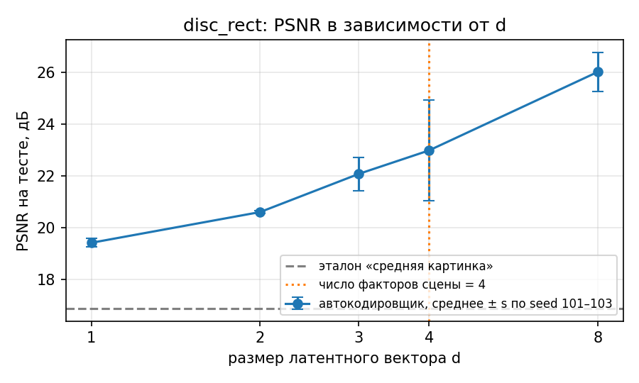
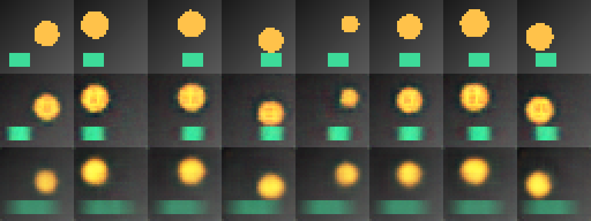

# Лабораторная работа №7

## Построение автокодировщика

**Дисциплина:** «Искусственный интеллект в креативных технологиях»  
**Вариант:** 7  
**Набор сцен:** №2 `disc_rect` — «диск и полоса»  
**Фактор:** №1 — размер латентного вектора, d = 8 → 2  
**Студент:** Провков Иван Александрович  
**Группа:** Т26ИИКТ-МИК11  
**Дата выполнения:** 27.10.2026

---

## 1. Цель, набор сцен, фактор, гипотеза и допуск

Цель работы — построить автокодировщик на синтетических сценах, измерить качество реконструкции на отложенной выборке и экспериментом выяснить, как на него влияет один фактор.

Вариант 7 = (2 − 1) · 6 + 1: набор сцен 2 × фактор 1. Сравниваются два режима на одних и тех же seed обучения 101…105:

| | Режим A | Режим B |
| --- | --- | --- |
| Архитектура | свёрточный автокодировщик `ConvAE` | тот же |
| Размер латентного вектора d | **8** | **2** |
| Функция потерь | MSE | MSE |
| Вход | чистые сцены | чистые сцены |
| Обучающая выборка | 4096 сцен, 20 эпох | то же |
| Оптимизатор | Adam, шаг 0,002, пакет 128 | то же |

Задача варианта — выяснить, что теряется при сжатии латентного вектора с 8 до 2 чисел, сравнить результат с эталоном «средняя картинка» и глазами проверить, восстанавливаются ли и диск, и полоса.

### Гипотеза и допуск

Гипотеза и допуск записаны **до запуска**, 27.10.2026 в 19:05 ([журнал](journal.md)).

> Сцена задаётся четырьмя независимыми факторами, поэтому два числа не могут закодировать её полностью. PSNR на тесте упадёт больше чем на 1 дБ, и сильнее, чем в демо-варианте с тремя факторами (−2,8 дБ). Разрыв train − test изменится в пределах ±0,1 дБ: потеря связана с ёмкостью узкого места, а не с переобучением. Время обучения изменится в пределах ±20 %. Оба режима будут лучше эталона «средняя картинка».

Дополнительно ожидалось, что в режиме B не восстановится радиус диска или положение полосы, а PSNR в развёртке по d перестанет расти примерно с d = 4 — по числу факторов сцены.

| Метрика | Допуск | Обоснование |
| --- | --- | --- |
| PSNR на тесте | ±1,0 дБ | образец методички; в демо разброс между seed `s ≈ 0,7` дБ, а разница меньше 1 дБ на сценах 32×32 визуально почти не заметна |
| Разрыв train − test | ±0,1 дБ | образец методички; в демо разрыв около 0,04 дБ, изменение меньше 0,1 дБ не говорит о переобучении |
| Время обучения | ±20 % от A | образец методички; время зависит от состояния GPU |

Направления: рост PSNR — «улучшение»; рост разрыва — «ухудшение» (сильнее переобучение); рост времени — «ухудшение». Изменение внутри допуска — «нейтрально».

Число параметров детерминировано: по устройству `ConvAE` оно равно 84 643 + 2049·d, то есть 101 035 при d = 8 и 88 741 при d = 2. Изменение известно до запуска, поэтому класс по допуску для параметров не назначается.

## 2. Данные, лицензии и ограничения

Данные синтетические и порождаются кодом `lab07_lib.py`, внешние файлы не загружаются. Функция `render("disc_rect", f)` рисует сцену 3×32×32 по вектору из четырёх факторов f = (f0, f1, f2, f3), каждый из отрезка [0, 1]:

- янтарный диск: центр x = 0,25 + 0,5·f0, y = 0,30 + 0,25·f1, радиус 0,12 + 0,08·f2;
- зелёная полоса внизу кадра (строки 0,72–0,92 высоты, ширина 0,3), левый край x = 0,05 + 0,55·f3;
- неподвижный градиентный фон.

`dataset("disc_rect")` порождает 4096 обучающих и 1024 тестовых сцены с seed 7, поэтому данные одинаковы для всех запусков. PSNR считается на тестовой выборке; разрыв — PSNR на 1024 обучающих сценах минус PSNR на тестовых.

Персональных данных и материалов с неподтверждёнными правами нет; предобученные веса не используются. Применяются открытые библиотеки PyTorch, NumPy и Pillow.

Ограничения: неподвижный фон и полоса упрощают задачу, и высокий PSNR частично обеспечивается фоном — поэтому результат сравнивается с эталоном «средняя картинка». Выводы о качестве не переносятся на фотографии без проверки.

## 3. Рабочая среда

| Параметр | Фактическое значение |
| --- | --- |
| Среда | Google Colab |
| GPU | Tesla T4, CUDA runtime 13.0 |
| Python | `3.13.16` |
| torch | `2.11.0+cu130` |
| numpy / Pillow | `2.1.3` / `11.3.0` |
| Platform | `Linux-6.6.159+-x86_64-with-glibc2.39` |
| Устройство обучения | `cuda` |

Версии близки к проверенным в методичке (Python 3.13.15, torch 2.11.0+cu128). Полная фиксация — в [environment.txt](environment.txt).

## 4. Ход работы

Ноутбук [lab07.ipynb](../lab07.ipynb) выполнен в Colab сверху вниз. Ниже — фрагменты кода из него без изменений.

1. Ячейки `%%writefile` записывают `lab07_lib.py` и `lab07_demo.py`; их SHA-256 сверяются с методичкой (`d84b83a8…`, `fce79249…`).
2. Проверяется, что режимы различаются ровно одним полем:

```python
A_CFG, B_CFG = L.settings(FACTOR)
changed = sorted(key for key in A_CFG if A_CFG[key] != B_CFG[key])
assert changed == ["d"], changed
```

3. Демонстрационный вариант 1 выполняется без изменений, его вывод сохраняется и сверяется с разделами 6.3–6.4 методички.
4. Обязательный вызов методички для варианта 7. Обёртка над `L.run` только записывает метрики каждого запуска, чтобы сохранить значения по seed; вычисления библиотеки не меняются:

```python
L.run = _logged_run
try:
    summary_started = time.perf_counter()
    summary = L.variant_summary(VARIANT)
    summary_seconds = time.perf_counter() - summary_started
finally:
    L.run = _original_run
```

5. Эталон «средняя картинка» для набора `disc_rect`:

```python
Xtr, Xte, Ftr, Fte = L.dataset(KIND)
mean_image = Xtr.mean(0, keepdim=True).expand_as(Xte)
baseline_psnr = L.psnr_images(mean_image, Xte)
```

6. Диагностика: PSNR при d = 1, 2, 3, 4, 8 (seed 101–103), как в демо, но для набора варианта:

```python
for d in SWEEP_D:
    vals = [L.run(KIND, dict(L.BASE, d=d), s)[0]["psnr"] for s in SWEEP_SEEDS]
```

7. Лист сравнения `comparison.png` строится кодом раздела 6.2 методички с `N = 7`; под ним выводятся факторы восьми показанных сцен.
8. Классификация по допуску, сравнение с критерием 2s и чувствительность к допуску (×0,5 и ×2).
9. Визуальная проверка, намеренная ошибка, паспорт и итоговая проверка: статус `COMPLETE`, `FULL CHECKLIST: PASS`.

Все измерения получены за один прогон. Выполнение остановилось на итоговой проверке, пока визуальная проверка не была заполнена; после заполнения заново выполнены только ячейки с визуальной проверки до конца.

## 5. Результаты

### 5.1. Таблица метрик (seed 101…105)

| Метрика | A (d = 8) | s | B (d = 2) | Δ | \|Δ\|/s | \|Δ\| > 2s |
| --- | ---: | ---: | ---: | ---: | ---: | :---: |
| PSNR на тесте, дБ | 26.193 | 0.628 | 20.603 | −5.590 | 8.90 | да |
| разрыв train − test, дБ | 0.0427 | 0.0069 | −0.0003 | −0.0429 | 6.26 | да |
| параметры, тыс. | 101.035 | 0 | 88.741 | −12.294 | — | да |
| время обучения, с | 1.922 | 0.040 | 1.903 | −0.019 | 0.47 | нет |

Для параметров `s = 0`, и признак 2s всегда «да» — для этой метрики он не несёт информации.

Значения по каждому seed:

| seed | PSNR A → B, дБ | разрыв A → B, дБ | время A → B, с |
| ---: | --- | --- | --- |
| 101 | 26.38 → 20.62 | 0.048 → −0.014 | 1.920 → 1.883 |
| 102 | 26.67 → 20.66 | 0.043 → 0.009 | 1.920 → 1.961 |
| 103 | 25.14 → 20.63 | 0.044 → −0.002 | 1.913 → 1.903 |
| 104 | 26.65 → 20.47 | 0.047 → −0.003 | 1.983 → 1.898 |
| 105 | 26.13 → 20.65 | 0.031 → 0.008 | 1.872 → 1.871 |

### 5.2. Эталон «средняя картинка»

| | PSNR на тесте, дБ | Выигрыш над эталоном, дБ |
| --- | ---: | ---: |
| Эталон «средняя картинка» | 16.89 | — |
| Режим A (d = 8) | 26.19 | +9.30 |
| Режим B (d = 2) | 20.60 | +3.71 |

Оба режима лучше эталона, но режим B сохраняет только 40 % выигрыша режима A.

### 5.3. Развёртка по размеру латентного вектора

| d | 1 | 2 | 3 | 4 | 8 |
| --- | ---: | ---: | ---: | ---: | ---: |
| PSNR, дБ (среднее по seed 101–103) | 19.42 | 20.60 | 22.08 | 22.98 | 26.01 |
| по seed 101 / 102 / 103 | 19.50 / 19.53 / 19.22 | 20.61 / 20.67 / 20.53 | 22.82 / 21.68 / 21.73 | 25.22 / 21.74 / 21.97 | 26.35 / 26.53 / 25.15 |



### 5.4. Лист сравнения

Строки: оригиналы восьми тестовых сцен, режим A (d = 8), режим B (d = 2); seed обучения 101.



| Фактор | сц. 1 | сц. 2 | сц. 3 | сц. 4 | сц. 5 | сц. 6 | сц. 7 | сц. 8 |
| --- | ---: | ---: | ---: | ---: | ---: | ---: | ---: | ---: |
| диск x | 0.77 | 0.06 | 0.69 | 0.84 | 1.00 | 0.59 | 0.34 | 0.10 |
| диск y | 0.62 | 0.12 | 0.08 | 0.98 | 0.09 | 0.24 | 0.05 | 0.80 |
| радиус | 0.71 | 0.90 | 0.89 | 0.65 | 0.05 | 0.68 | 0.99 | 0.88 |
| полоса x | 0.14 | 0.18 | 0.77 | 0.88 | 0.74 | 0.66 | 0.54 | 0.37 |

PSNR на этих восьми сценах: A — 25,75 дБ, B — 20,57 дБ.

### 5.5. Визуальное описание

- **A (d = 8):** диск и полоса восстановлены во всех восьми сценах на своих местах; маленький диск сцены 5 (радиус 0,05) остаётся маленьким. Края обоих объектов размыты, внутри диска заметны слабые тёмные артефакты.
- **B (d = 2):** диск — размытое пятно примерно на своём месте, но почти одного размера во всех сценах: маленький диск сцены 5 и большие в сценах 2, 7, 8 выглядят одинаково. Полоса превратилась в бледную ленту через всю нижнюю часть кадра.
- **Проверка задания** («и диск, и полоса восстанавливаются, границы не размываются»): A — да, с размытием краёв; B — нет. В режиме B потеряны два фактора сцены: радиус диска и положение полосы.

### 5.6. Воспроизведение демонстрационного варианта

| Метрика | A | B | Δ | 2s | Методичка (A / B / Δ) |
| --- | ---: | ---: | ---: | :---: | --- |
| PSNR, дБ | 26.012 | 23.192 | −2.820 | да | 26.00 / 23.20 / −2.80 |
| разрыв, дБ | 0.034 | 0.097 | +0.063 | да | 0.040 / 0.101 / +0.061 |
| параметры, тыс. | 101.035 | 88.741 | −12.294 | да | 101.0 / 88.7 / −12.3 |
| время, с | 1.969 | 1.909 | −0.059 | нет | 2.27 / 2.10 / −0.17 |

Эталон «средняя картинка» для набора «диск» — 17,171 дБ, как в методичке. Развёртка по d: 20,64 / 23,16 / 25,21 / 26,46 / 25,77 дБ при d = 1, 2, 3, 4, 8 (в методичке 20,64 / 23,16 / 25,24 / 26,45 / 25,70). Все PSNR и разрывы лежат в пределах 2s от методички, выводы по критерию 2s те же. Обучение на GPU не побитово детерминировано, поэтому совпадение проверяется в пределах разброса между seed, а не до последнего знака. Время короче примерно на 13 %: оно зависит от GPU.

Для варианта 7 в комплекте преподавателя есть результат полного прогона: PSNR A 26,22 / B 20,60 дБ, разрыв 0,045 / −0,002 дБ, время 2,13 / 2,11 с. Наши значения совпадают с ним в пределах разброса между seed.

## 6. Анализ

### 6.1. Классификация по допуску

| Метрика | Изменение | Допуск | Класс | \|Δ\| > 2s | 2s и допуск согласуются |
| --- | ---: | ---: | --- | :---: | :---: |
| PSNR на тесте | −5.590 дБ | ±1.0 дБ | **ухудшение** | да | да |
| разрыв train − test | −0.043 дБ | ±0.1 дБ | **нейтрально** | да | **нет** |
| время обучения | −1.0 % | ±20 % | **нейтрально** | нет | да |

Число параметров уменьшилось на 12,2 %: изменились только последний слой кодировщика (1024·d + d весов) и первый слой декодировщика (1024·d + 1024).

Сверка с гипотезой:

- PSNR упал на 5,59 дБ — больше допуска и в два раза сильнее, чем в демо с тремя факторами (−2,82 дБ). **Подтверждено.**
- Разрыв train − test изменился на −0,043 дБ — в пределах допуска. **Подтверждено.**
- Время изменилось на −1,0 % — в пределах допуска. **Подтверждено.**
- Оба режима лучше эталона: +9,30 и +3,71 дБ. **Подтверждено.**
- В режиме B потеряны радиус диска и положение полосы. **Подтверждено.**
- Рост PSNR прекращается примерно с d = 4. **Не подтверждено:** между d = 4 и d = 8 ещё +3 дБ.

### 6.2. Статистическая значимость и практическая польза

Для PSNR и времени критерий 2s и допуск согласуются: падение PSNR и выходит за разброс между seed (|Δ|/s = 8,90), и практически существенно; изменение времени не значимо ни по одному критерию.

Для разрыва train − test они **расходятся**: изменение значимо по 2s (|Δ|/s = 6,26), но меньше допуска ±0,1 дБ. Причина — очень малый разброс разрыва между seed (`s = 0,007` дБ): при таком `s` критерий 2s срабатывает на практически неважную разницу. Это тот же случай, что в демо-варианте методички.

**Чувствительность к допуску.** При половинном и при двукратном допуске классы не меняются: падение PSNR в 5,6 раза больше допуска, а изменения разрыва и времени — меньше половины допуска. Вывод от выбора допуска не зависит.

### 6.3. Наблюдение и объяснение

Наблюдения — разделы 5.1–5.5. Ниже — объяснения; отдельными экспериментами они не проверялись.

- **Почему B теряет именно радиус и положение полосы.** Два числа не могут закодировать четыре независимых фактора. MSE сильнее всего штрафует ошибку в положении крупного яркого диска, поэтому выгоднее потратить оба числа на координаты диска, а радиус и полосу передать «в среднем». Это согласуется с листом: положение диска в B примерно сохранено, а полоса вырождается в среднюю ленту по всей ширине — похоже на среднее по всем положениям полосы.
- **Почему разрыв в B около нуля.** Узкое место ограничивает ёмкость, и сеть одинаково недообучена на обучающих и тестовых сценах; переобучаться ей нечем. В режиме A разрыв 0,04 дБ — тоже мал, т. е. оба режима хорошо обобщают.
- **Почему время не изменилось.** Размер d влияет только на два полносвязных слоя у узкого места; основное время уходит на свёрточные слои, которые от d не зависят.
- **Почему при d = 4 качество нестабильно.** Четырёх чисел теоретически достаточно для четырёх факторов, но только если обучение найдёт кодирование, в котором используются все четыре. При seed 101 это удалось (25,2 дБ), при seed 102 и 103 PSNR остался около 21,8 дБ — на уровне d = 3. Возможное объяснение — за 20 эпох сеть застревает в решении, где одно из чисел почти не используется; при d = 8 запас размерности делает обучение устойчивым. Проверить это можно листами сравнения для d = 4 по каждому seed и обучением на большее число эпох.
- **Отличие от демо.** В наборе «диск» (3 фактора) качество выходит на плато уже при d = 4 (26,46 дБ при d = 4 против 25,77 при d = 8). В наборе «диск и полоса» четвёртый фактор делает d = 4 пограничным размером, и устойчивое качество достигается только при d = 8.

### 6.4. Намеренная ошибка

**Симптом.** Оценка «PSNR = 20,6 дБ при d = 2 — больше двадцати, значит, двух чисел достаточно» выглядит убедительно.

**Диагностика.** PSNR нельзя оценивать без эталона. Средняя картинка обучающей выборки, не зависящая от входа, даёт на тесте 16,89 дБ: режим B выигрывает у неё только 3,71 дБ, а режим A — 9,30 дБ. Развёртка по d показывает, что качество растёт вплоть до d = 8, а лист сравнения — что в режиме B потеряны два из четырёх факторов сцены.

**Исправление.** Каждый вывод о качестве сопровождается эталоном и выигрышем над ним; размер узкого места выбирается развёрткой по d, а не одним значением; оценка идёт на тестовой выборке, а разрыв train − test отделяет потерю ёмкости от переобучения.

### 6.5. Угрозы валидности

- Один набор сцен, одна архитектура, один фактор, пять seed; развёртка по d — только три seed.
- Синтетические сцены 32×32 с гладким неподвижным фоном; фон и полоса частично обеспечивают высокий PSNR.
- PSNR не различает размытие и смещение объекта: B может «получить» PSNR за правильный фон при неверной полосе.
- Обучение на GPU не побитово детерминировано; значения воспроизводятся в пределах разброса между seed.
- Время обучения зависит от состояния GPU.
- Визуальную проверку выполнял один человек по восьми сценам одного seed.

## 7. Вывод

Уменьшение латентного вектора с 8 до 2 чисел на наборе «диск и полоса»:

- снизило PSNR на тесте на 5,59 дБ (с 26,19 до 20,60 дБ; |Δ|/s = 8,90) — «ухудшение» по допуску;
- практически не изменило разрыв train − test (−0,043 дБ, «нейтрально», хотя по 2s изменение значимо) и время обучения (−1,0 %);
- уменьшило число параметров на 12,2 %.

Оба режима лучше эталона «средняя картинка» (16,89 дБ), но режим B сохраняет только 40 % выигрыша режима A. На листе сравнения в режиме B потеряны радиус диска и положение полосы. Основное объяснение — нехватка ёмкости узкого места: сцена задаётся четырьмя факторами, а не двумя. Гипотеза подтверждена; не подтвердилось только ожидание плато качества с d = 4 — при d = 4 обучение нестабильно, и устойчивое качество достигается при d = 8.

Вывод относится к свёрточному автокодировщику из `lab07_lib.py`, набору `disc_rect`, 20 эпохам обучения и seed 101…105 и не переносится на фотографии и другие архитектуры без проверки.

**Вопрос для обсуждения.** Почему двух чисел мало для набора с четырьмя факторами, а четырёх — не всегда достаточно? Подтвердить объяснение можно развёрткой по d на большем числе seed и с увеличенным числом эпох при d = 4.

Статус работы: **PASS**.

## 8. Ссылки и паспорт

- [Ноутбук с outputs](../lab07.ipynb)
- [Паспорт эксперимента](../artifacts/passport.json) — статус `COMPLETE`, версии среды, параметры обоих режимов
- [Таблица метрик](../artifacts/metrics.json), [значения по seed](../artifacts/per_seed_metrics.csv), [классификация](../artifacts/classification.json)
- [Эталон](../artifacts/baseline.json), [развёртка по d](../artifacts/latent_sweep.json), [график развёртки](../artifacts/latent_sweep.png)
- [Лист сравнения](../artifacts/comparison.png), [факторы сцен листа](../artifacts/comparison_factors.csv)
- [Намеренная ошибка](../artifacts/intentional_error.json), [воспроизведение демо](../artifacts/demo/demo_variant01.json)
- [Параметры варианта](../configs/run_config.json), [журнал](journal.md), [среда](environment.txt), [подготовка к защите](defense.md)

Корень репозитория: [github.com/oneway192/ai-in-ci](https://github.com/oneway192/ai-in-ci).

## 9. Индивидуальный вклад

Студент:

- записал гипотезу, допуск и правила классификации до запуска и заранее рассчитал изменение числа параметров;
- выполнил ноутбук в Google Colab на T4, воспроизвёл демонстрационный вариант и сверил его с методичкой;
- выполнил вариант 7, вычислил эталон «средняя картинка» и развёртку по размеру латентного вектора;
- провёл визуальную проверку и определил, какие факторы сцены теряются при d = 2;
- классифицировал отклик, проанализировал расхождение критерия 2s и допуска и нестабильность обучения при d = 4.
