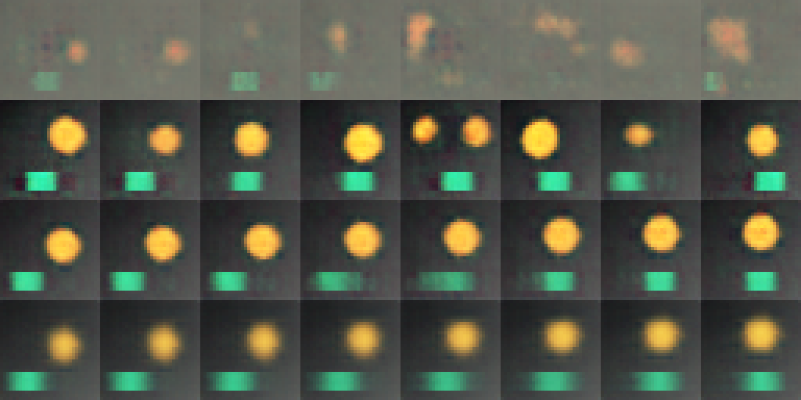
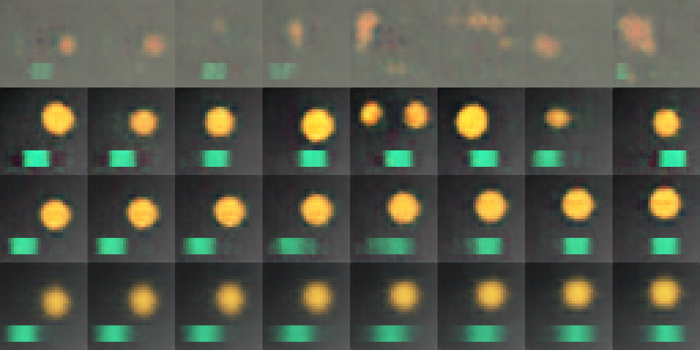
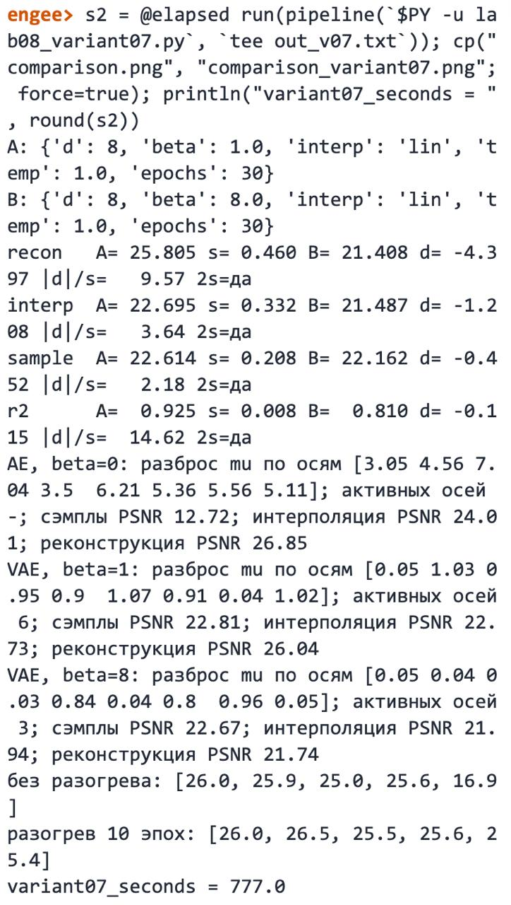

# Лабораторная работа №8

## Генерация и интерполяция в латентном пространстве

**Дисциплина:** «Искусственный интеллект в креативных технологиях»  
**Вариант:** 7  
**Набор сцен:** №2 `disc_rect` — «диск и полоса»  
**Фактор:** №1 — вес KL-члена, β = 1 → 8  
**Студент:** Провков Иван Александрович  
**Группа:** Т26ИИКТ-МИК11  
**Дата выполнения:** 27.10.2026

---

## 1. Цель, набор сцен, фактор, гипотеза и допуск

Цель работы — построить вариационный автокодировщик на синтетических сценах, получить из него новые изображения (сэмплы из априорного распределения) и промежуточные сцены (интерполяция между двумя изображениями) и экспериментом выяснить, как на качество реконструкции, интерполяции и сэмплов влияет один фактор.

Вариант 7 = (2 − 1) · 6 + 1: набор сцен 2 × фактор 1. Сравниваются два режима на одних и тех же seed обучения 101…105:

| | Режим A | Режим B |
| --- | --- | --- |
| Модель | вариационный автокодировщик `ConvVAE` | тот же |
| Вес KL-члена β | **1** | **8** |
| Размер латентного вектора d | 8 | 8 |
| Интерполяция | линейная | линейная |
| Сэмплы | из N(0, I), τ = 1 | то же |
| Обучение | 30 эпох, разогрев KL-члена 10 эпох, Adam, шаг 0,002, пакет 128 | то же |

Задача варианта — оценить, как меняются реконструкция, интерполяция, сэмплы и линейная связь латентных осей с факторами сцены, найти число активных осей латентного вектора в обоих режимах и глазами проверить, что по пути интерполяции диск движется, а полоса смещается, не исчезая.

### Гипотеза и допуск

Гипотеза и допуск записаны **до запуска**, 27.10.2026 в 21:00 ([журнал](journal.md)).

> При β = 8 KL-член «дорого» берёт за каждую используемую ось, и часть осей станет неактивной; в демо-варианте с тремя факторами при β = 8 активны две оси, а у набора «диск и полоса» факторов четыре. Поэтому реконструкция упадёт больше чем на 1 дБ, R² факторов — больше чем на 0,05, интерполяция — больше чем на 1 дБ; качество сэмплов изменится в пределах ±1 дБ. Активных осей при β = 1 будет не меньше четырёх, при β = 8 — меньше четырёх.

| Метрика | Допуск | Обоснование |
| --- | --- | --- |
| Реконструкция | ±1,0 дБ | образец методички и тот же порог, что в ЛР07; в демо разброс между seed `s ≈ 0,6` дБ |
| Интерполяция | ±1,0 дБ | образец методички; в демо `s ≈ 0,5` дБ, разница меньше 1 дБ на сценах 32×32 визуально почти не заметна |
| Сэмплы | ±1,0 дБ | образец методички; в демо `s ≈ 0,6` дБ |
| R² факторов | ±0,05 | образец методички; в демо `s ≈ 0,02`, а 0,05 — это 5 % дисперсии факторов |

Направления: рост любой метрики — «улучшение», падение — «ухудшение»; изменение внутри допуска — «нейтрально». Фактор β меняет саму модель, поэтому все четыре метрики затрагиваются им, и контрольных метрик в варианте нет.

## 2. Данные, модели, лицензии и ограничения

Данные синтетические и порождаются кодом `lab07_lib.py` из ЛР07, внешние файлы не загружаются. Функция `render("disc_rect", f)` рисует сцену 3×32×32 по четырём факторам f = (f0, f1, f2, f3), каждый из отрезка [0, 1]: положение янтарного диска по x и y, его радиус и положение зелёной полосы внизу кадра; фон — неподвижный градиент. `dataset("disc_rect")` порождает 4096 обучающих и 1024 тестовые сцены с seed 7.

Модель `ConvVAE` из `lab08_lib.py` — свёрточный автокодировщик ЛР07, у которого кодировщик выдаёт среднее μ и логарифм дисперсии латентного вектора. Потери на одно изображение — сумма квадратов ошибок по пикселям плюс β · KL, где KL = −0,5 · Σ (1 + log σ² − μ² − σ²) по осям; вес KL-члена растёт линейно от 0 до β за первые 10 эпох. При β = 0 потери сводятся к ошибке реконструкции, и это обычный автокодировщик.

Метрики (`lab08_lib.metrics`):

- **реконструкция** — PSNR восстановления 1024 тестовых сцен по μ;
- **интерполяция** — PSNR изображений на линейном пути при t = 0,25; 0,5; 0,75 относительно сцены, построенной по средним значениям факторов пары (200 пар), среднее по трём точкам;
- **сэмплы** — средний по 256 сэмплам из N(0, I) PSNR ближайшей тестовой сцены;
- **R² факторов** — доля дисперсии факторов сцены, восстанавливаемая линейно по μ (обучение на обучающих сценах, проверка на тестовых), среднее по четырём факторам;
- **активная ось** — ось латентного вектора со средним KL больше 0,05 нат.

Персональных данных и материалов с неподтверждёнными правами нет; предобученные веса не используются. Применяются открытые библиотеки PyTorch, NumPy и Pillow.

Ограничения: неподвижный фон и полоса упрощают задачу, и PSNR частично определяется фоном — поэтому реконструкция сравнивается с эталоном «средняя картинка» из ЛР07. Эталон для интерполяции существует только потому, что сцены порождаются кодом; для реальных изображений его нет. Выводы не переносятся на фотографии без проверки.

## 3. Рабочая среда

| Параметр | Фактическое значение |
| --- | --- |
| Среда | Google Colab |
| GPU | Tesla T4, CUDA runtime 13.0 |
| Python | `3.13.16` |
| torch | `2.11.0+cu130` |
| numpy / Pillow | `2.1.3` / `11.3.0` |
| Platform | `Linux-6.6.159+-x86_64-with-glibc2.39` |
| Устройство обучения | `cuda` |

Методичка рассчитана на Engee (процессор, PyTorch 2.4.1), но та же библиотека проверена преподавателем и в Google Colab на T4. Работа выполнена в Colab, как ЛР05–ЛР07; выполненный ноутбук с выводом ячеек заменяет снимок консоли Engee. Полная фиксация — в [environment.txt](environment.txt). Для сверки работа дополнительно выполнена в Engee (раздел 5.7); среда Engee зафиксирована в [engee/environment.txt](../engee/environment.txt).

## 4. Ход работы

Ноутбук [lab08.ipynb](../lab08.ipynb) выполнен в Colab сверху вниз. Ниже — фрагменты кода из него без изменений.

1. Ячейки `%%writefile` записывают `lab07_lib.py`, `lab08_lib.py` и `lab08_demo.py`; их SHA-256 сверяются с методичкой (`d84b83a8…`, `f414c49b…`, `8ab781bf…`).
2. Проверяется, что режимы различаются ровно одним полем:

```python
A_CFG, B_CFG = V.settings(FACTOR)
changed = sorted(key for key in A_CFG if A_CFG[key] != B_CFG[key])
assert changed == ["beta"], changed
```

3. Демонстрационный вариант 1 выполняется без изменений, его вывод сохраняется и сверяется с разделами 6.3–6.4 методички.
4. Обязательный вызов методички для варианта 7. Обёртка над `V.run` только записывает метрики каждого запуска; вычисления библиотеки не меняются:

```python
V.run = _logged_run
try:
    summary_started = time.perf_counter()
    summary = V.variant_summary(VARIANT)
    summary_seconds = time.perf_counter() - summary_started
finally:
    V.run = _original_run
```

5. Диагностика осей — разброс μ, KL по осям и число активных осей:

```python
@torch.no_grad()
def axis_stats(model):
    mu, lv = model.encode_dist(Xte)
    kl_axis = (-0.5 * (1 + lv - mu ** 2 - lv.exp())).mean(0)
    return mu.std(0).cpu().numpy(), kl_axis.cpu().numpy()
```

Для seed 101 она считается у обычного автокодировщика (β = 0) и вариационных (β = 1 и 8), а для режимов A и B — по каждому seed на уже обученных моделях.

6. Эталон «средняя картинка» из ЛР07 для набора `disc_rect`.
7. Намеренная ошибка 1: обучение с β = 1 без разогрева KL-члена и с разогревом 10 эпох, метрики по каждому seed.
8. Намеренная ошибка 2: сэмплы из N(0, I) у обычного автокодировщика и исправление — сэмплы из распределения μ на обучающих сценах:

```python
sampling[name] = {"prior_N01": nearest_psnr(model, eps), "fitted_to_train_mu": nearest_psnr(model, mu_tr.mean(0) + eps * mu_tr.std(0))}
```

9. Лист сравнения `comparison.png` кодом раздела 6.2 методички с `N = 7`, классификация по допуску, визуальная проверка, паспорт и итоговая проверка: статус `COMPLETE`, `FULL CHECKLIST: PASS`.

Все измерения получены за один прогон. Выполнение остановилось на итоговой проверке, пока визуальная проверка не была заполнена; после заполнения заново выполнены только ячейки с визуальной проверки до конца.

## 5. Результаты

### 5.1. Таблица метрик (seed 101…105)

| Метрика | A (β = 1) | s | B (β = 8) | Δ | \|Δ\|/s | \|Δ\| > 2s |
| --- | ---: | ---: | ---: | ---: | ---: | :---: |
| реконструкция, дБ | 25.788 | 0.494 | 21.427 | −4.361 | 8.82 | да |
| интерполяция, дБ | 22.703 | 0.335 | 21.516 | −1.187 | 3.54 | да |
| сэмплы, дБ | 22.633 | 0.180 | 22.167 | −0.467 | 2.59 | да |
| R² факторов | 0.926 | 0.011 | 0.845 | −0.081 | 7.64 | да |

Значения по каждому seed (A → B):

| seed | реконструкция, дБ | интерполяция, дБ | сэмплы, дБ | R² |
| ---: | --- | --- | --- | --- |
| 101 | 26.06 → 21.74 | 22.71 → 21.95 | 22.86 → 22.69 | 0.924 → 0.886 |
| 102 | 26.53 → 21.76 | 23.26 → 21.63 | 22.61 → 22.24 | 0.942 → 0.786 |
| 103 | 25.43 → 21.37 | 22.54 → 21.59 | 22.40 → 22.18 | 0.929 → 0.863 |
| 104 | 25.40 → 21.47 | 22.62 → 21.47 | 22.76 → 22.18 | 0.924 → 0.792 |
| 105 | 25.52 → 20.79 | 22.38 → 20.95 | 22.53 → 21.54 | 0.912 → 0.898 |

Все четыре метрики снизились на каждом из пяти seed.

**Эталон «средняя картинка»:** 16,89 дБ. Выигрыш реконструкции над ним: A — +8,90 дБ, B — +4,53 дБ.

### 5.2. Диагностика латентного пространства

Активные оси (KL > 0,05 нат) по seed:

| seed | 101 | 102 | 103 | 104 | 105 |
| --- | ---: | ---: | ---: | ---: | ---: |
| A (β = 1) | 6 | 6 | 6 | 6 | 6 |
| B (β = 8) | 3 | 4 | 3 | 4 | 4 |

Суммарный KL на сцену: A — 9,1–9,8 нат, B — 1,7–2,4 нат.

Три модели при seed 101 (AE — обычный автокодировщик, VAE — вариационный):

| Модель | Разброс μ | Активных осей | Реконструкция, дБ | Интерполяция, дБ | Сэмплы, дБ | R² |
| --- | --- | ---: | ---: | ---: | ---: | ---: |
| AE, β = 0 | 3,0–7,2 | — | 26.85 | 24.04 | 12.71 | 0.966 |
| VAE, β = 1 | 0,04–1,07 | 6 | 26.06 | 22.71 | 22.86 | 0.924 |
| VAE, β = 8 | 0,03–0,97 | 3 | 21.74 | 21.95 | 22.69 | 0.886 |

У модели β = 1 две оси из восьми почти не используются (разброс μ 0,04–0,06), у модели β = 8 — пять из восьми.

### 5.3. Лист сравнения

Строки: 1 — сэмплы обычного автокодировщика из N(0, I); 2 — сэмплы VAE β = 1 из тех же z; 3 — линейный путь между тестовыми сценами 0 и 2 при β = 1; 4 — тот же путь при β = 8. Модели обучены с seed 101.



| Конец пути (тестовая сцена) | диск x | диск y | радиус | полоса x |
| --- | ---: | ---: | ---: | ---: |
| сцена 0 (t = 0) | 0.77 | 0.62 | 0.71 | 0.14 |
| сцена 2 (t = 1) | 0.69 | 0.08 | 0.89 | 0.77 |

### 5.4. Визуальное описание

- **Сэмплы обычного автокодировщика:** серые размытые пятна с бледными оранжевыми следами, диск и полоса не читаются.
- **Сэмплы VAE β = 1:** в 7 из 8 — узнаваемые сцены с диском и полосой; в пятом сэмпле два диска — такой сцены в наборе нет.
- **Путь β = 1:** диск плавно смещается вверх и немного увеличивается, полоса переходит слева направо; в средних кадрах полоса растянута и полупрозрачна, но не исчезает.
- **Путь β = 8:** та же траектория, но диск заметно размыт, полоса в середине пути сильнее растянута в ленту.
- **Проверка задания** («диск движется по пути интерполяции, полоса смещается, не исчезая»): выполнено в обоих режимах; при β = 8 — с более сильным размытием.

### 5.5. Воспроизведение демонстрационного варианта

| Метрика | A | B | Δ | 2s | Методичка (A / B / Δ) |
| --- | ---: | ---: | ---: | :---: | --- |
| реконструкция, дБ | 26.344 | 22.546 | −3.797 | да | 26.37 / 22.53 / −3.84 |
| интерполяция, дБ | 22.614 | 21.984 | −0.630 | нет | 22.55 / 21.90 / −0.65 |
| сэмплы, дБ | 23.246 | 23.278 | +0.032 | нет | 23.24 / 23.21 / −0.03 |
| R² факторов | 0.900 | 0.803 | −0.097 | да | 0.899 / 0.786 / −0.114 |

Все значения лежат в пределах 2s от методички, выводы по критерию 2s те же. Диагностика seed 101: у обычного автокодировщика сэмплы 12,81 дБ (в методичке 12,86), у VAE β = 8 — 2 активные оси (как в методичке), у VAE β = 1 — 6 осей (в методичке 7 в Engee и 8 в Colab). Схлопывание без разогрева воспроизвелось на том же seed 102 (17,2 дБ, как в методичке). Обучение на GPU не побитово детерминировано, поэтому совпадение проверяется в пределах разброса между seed.

Для варианта 7 в комплекте преподавателя есть результаты полного прогона: в Engee 25,72 → 21,43 дБ; 22,65 → 21,46 дБ; 22,58 → 22,15 дБ; R² 0,924 → 0,796; в Colab 25,76 → 21,34; 22,66 → 21,43; 22,60 → 22,12; 0,924 → 0,808. Наши значения совпадают с ними по картине; R² режима B у нас выше (0,845), но в пределах разброса B по seed (0,79–0,90).

### 5.7. Дополнительный прогон в Engee

Чтобы выполнить работу и на платформе методички, демо-вариант и вариант 7 дополнительно прогнаны в Engee 26.10.2-H1 (процессор, Julia 1.12.6, Python 3.11.11). В окружении `/user/.user_venvs/py3.11` не было PyTorch, поэтому перед запуском установлена версия из методички — `torch==2.4.1` в сборке для процессора. Файлы загружены в `/user/ai-in-ci/LR08`; SHA-256 на сервере совпали с локальными. Скрипты запущены из командной строки Engee: `lab08_demo.py` как есть и `lab08_variant07.py` — тот же код с `N = 7`; вывод сохранён в файлы и снят снимками консоли.

**Демонстрационный вариант в Engee совпал с методичкой до последнего напечатанного знака**: реконструкция 26,372 → 22,529 дБ, интерполяция 22,553 → 21,902 дБ, сэмплы 23,242 → 23,210 дБ, R² 0,899 → 0,786; разброс μ, число активных осей (7 и 2) и значения схлопывания без разогрева (26,5; 17,2; 25,7; 26,7; 24,7 дБ) те же. Обучение на процессоре с той же версией PyTorch и тем же числом потоков оказалось воспроизводимым между разными версиями Engee.

Вариант 7, Engee против Colab:

| Метрика | A Engee | A Colab | B Engee | B Colab | Δ Engee | Δ Colab | Класс Engee |
| --- | ---: | ---: | ---: | ---: | ---: | ---: | --- |
| реконструкция, дБ | 25.805 | 25.788 | 21.408 | 21.427 | −4.397 | −4.361 | ухудшение |
| интерполяция, дБ | 22.695 | 22.703 | 21.487 | 21.516 | −1.208 | −1.187 | ухудшение |
| сэмплы, дБ | 22.614 | 22.633 | 22.162 | 22.167 | −0.452 | −0.467 | нейтрально |
| R² факторов | 0.925 | 0.926 | 0.810 | 0.845 | −0.115 | −0.081 | ухудшение |

- Значения режима A различаются не больше чем на 0,02 дБ и 0,001 по R²; режима B — не больше чем на 0,03 дБ, кроме R² (0,810 против 0,845, в пределах разброса B по seed). Классы по допуску и признаки 2s те же; для сэмплов в Engee критерий 2s и допуск тоже расходятся.
- Диагностика seed 101 в Engee: обычный автокодировщик — сэмплы 12,72 дБ; VAE β = 1 — 6 активных осей; VAE β = 8 — 3 активные оси (в Colab 12,71 дБ, 6 и 3).
- Схлопывание без разогрева в Engee повторилось на том же seed 105: 26,0; 25,9; 25,0; 25,6; **16,9** дБ; с разогревом — 26,0; 26,5; 25,5; 25,6; 25,4 дБ.
- Листы сравнения Engee и Colab для варианта 7 визуально совпадают (PSNR между ними 41,6 дБ).
- Время на процессоре Engee: демо — 830 с, вариант 7 — 777 с (в Colab на T4 — 86 и 36 с для соответствующих частей ноутбука).
- От прогона преподавателя для варианта 7 в Engee (25,72 → 21,43 дБ) наши числа отличаются на 0,02–0,08 дБ. Возможная причина — число потоков: сводный прогон преподавателя выполнялся по одному потоку на процесс, а наш, как и его демо, — на четырёх; порядок суммирования меняет последние знаки.





## 6. Анализ

### 6.1. Классификация по допуску

| Метрика | Δ | Допуск | Класс | \|Δ\| > 2s | 2s и допуск согласуются |
| --- | ---: | ---: | --- | :---: | :---: |
| реконструкция | −4.361 дБ | ±1.0 дБ | **ухудшение** | да | да |
| интерполяция | −1.187 дБ | ±1.0 дБ | **ухудшение** | да | да |
| сэмплы | −0.467 дБ | ±1.0 дБ | **нейтрально** | да | **нет** |
| R² факторов | −0.081 | ±0.05 | **ухудшение** | да | да |

Сверка с гипотезой:

- Реконструкция −4,36 дБ, R² −0,081, интерполяция −1,19 дБ — все за пределами допуска. **Подтверждено.**
- Сэмплы −0,47 дБ — в пределах допуска. **Подтверждено.**
- Активных осей при β = 1 — 6, не меньше четырёх. **Подтверждено.**
- Активных осей при β = 8 меньше четырёх. **Подтверждено частично:** 3 оси на двух seed, 4 оси на трёх.

### 6.2. Статистическая значимость и практическая польза

Для реконструкции, интерполяции и R² критерий 2s и допуск согласуются: изменения и выходят за разброс между seed, и практически существенны.

Для сэмплов они **расходятся**: снижение значимо по 2s (|Δ|/s = 2,59), но меньше допуска ±1 дБ. Причина — малый разброс PSNR сэмплов между seed (`s = 0,18` дБ): критерий срабатывает на разницу, которую мы заранее признали неважной.

**Чувствительность к допуску.** При двукратном допуске интерполяция (−1,19 против ±2,0) и R² (−0,081 против ±0,10) становятся «нейтрально»; «ухудшение» остаётся только у реконструкции. При половинном допуске классы не меняются. Вывод о реконструкции устойчив, выводы об интерполяции и R² зависят от выбора допуска: интерполяция лишь немного превысила порог 1 дБ.

### 6.3. Наблюдение и объяснение

Наблюдения — разделы 5.1–5.4. Ниже — объяснения; отдельными экспериментами они не проверялись, кроме оговорённых.

- **Почему падает реконструкция.** При β = 8 каждый нат информации в латентном векторе стоит в восемь раз дороже. Модель отвечает тем, что сокращает передаваемую информацию: суммарный KL падает с 9–10 до 2–2,5 нат на сцену, активных осей становится 3–4 вместо 6. Декодировщику остаётся меньше сведений о сцене, и он рисует более размытое «типичное» изображение — это видно на листе (размытый диск в строке 4). Объяснение подтверждено диагностикой осей.
- **Почему R² падает.** С меньшим числом активных осей четыре фактора приходится кодировать теснее, частично нелинейно или совместно, и линейное восстановление факторов хуже. Какой именно фактор пострадал сильнее, не проверялось: библиотека возвращает R² только усреднённым по факторам.
- **Почему интерполяция падает меньше реконструкции** (−1,19 против −4,36 дБ). Даже при β = 1 середина пути неидеальна — полоса в средних кадрах растянута, и PSNR интерполяции ограничен уровнем около 22,7 дБ. Размытие при β = 8 добавляется к этой ошибке, а не умножает её.
- **Почему сэмплы почти не изменились.** Эффекты действуют в разные стороны: при β = 8 латентное распределение ближе к N(0, I), и сэмплы лучше попадают в обученную область, но декодировщик рисует размыто. PSNR ближайшего соседа к тому же не чувствителен к разнообразию сэмплов.
- **Почему 4 активные оси не спасают.** На трёх seed из пяти при β = 8 активны ровно 4 оси — по числу факторов, но качество всё равно ниже: активная ось при β = 8 передаёт меньше информации (KL по оси 0,6–1,2 нат против 1,2–2,1 при β = 1), т. е. факторы кодируются грубее.
- **Обычный автокодировщик интерполирует лучше.** При seed 101 интерполяция у AE 24,04 дБ против 22,71 у VAE β = 1: для пути между двумя закодированными сценами KL-член не нужен. Он нужен для сэмплирования (12,71 против 22,86 дБ) — так же, как в методичке.

### 6.4. Намеренные ошибки

**Ошибка 1: VAE обучен с β = 1 «сразу» и оценён только по среднему.**

| Обучение | seed 101 | 102 | 103 | 104 | 105 |
| --- | ---: | ---: | ---: | ---: | ---: |
| β = 1 сразу, реконструкция, дБ | 25.97 | 25.76 | 25.11 | 25.59 | **16.88** |
| β = 1 сразу, активных осей | 5 | 6 | 6 | 5 | **0** |
| разогрев 10 эпох, реконструкция, дБ | 26.04 | 26.51 | 25.44 | 25.43 | 25.46 |
| разогрев 10 эпох, активных осей | 6 | 6 | 6 | 6 | 6 |

**Симптом.** Без разогрева один запуск из пяти даёт реконструкцию 16,88 дБ. **Диагностика.** Это уровень эталона «средняя картинка» (16,89 дБ), активных осей 0, R² 0,33 — латентный вектор не несёт информации о сцене, произошло схлопывание апостериорного распределения. Среднее по seed скрывает такой запуск. На наборе «диск и полоса» схлопнулся seed 105, в демо на наборе «диск» — seed 102: какой запуск схлопнется, зависит и от seed, и от данных. **Исправление.** Разогрев KL-члена 10 эпох — ни один запуск не схлопнулся, 25,4–26,5 дБ; анализировать значения по каждому seed.

**Ошибка 2: сэмплы из N(0, I) у обычного автокодировщика.**

| Модель (seed 101) | Сэмплы из N(0, I), дБ | Сэмплы из N(среднее μ, разброс μ), дБ |
| --- | ---: | ---: |
| обычный автокодировщик, β = 0 | 12.71 | 20.21 |
| вариационный, β = 1 | 22.86 | 22.98 |

**Симптом.** Сэмплы обычного автокодировщика — бесформенные пятна (строка 1 листа). **Диагностика.** Его латентные векторы не согласованы с N(0, I) — разброс μ по осям 3,0–7,2, и сэмплы из N(0, I) попадают туда, где декодировщик не обучался. **Исправление.** KL-член, либо сэмплы из распределения μ, оценённого на обучающих сценах; второй способ поднимает PSNR сэмплов AE с 12,7 до 20,2 дБ, но не до уровня VAE (22,9 дБ), так как независимые оси с подобранными средними и разбросом не повторяют совместное распределение μ.

### 6.5. Угрозы валидности

- Один набор сцен, одна архитектура, один фактор, пять seed, 30 эпох; диагностика трёх моделей — только seed 101.
- Синтетические сцены 32×32 с неподвижным фоном; фон частично обеспечивает PSNR.
- PSNR ближайшего соседа не проверяет разнообразие сэмплов: все сэмплы могли бы совпасть с одной сценой.
- R² — линейная мера, усреднённая по факторам; хорошее значение не означает «распутанности» осей.
- Порог активной оси 0,05 нат взят из методички; при другом пороге число осей может измениться.
- Обучение на GPU не побитово детерминировано; значения воспроизводятся в пределах разброса между seed.
- Визуальную проверку выполнял один человек по одному листу seed 101.

## 7. Вывод

Увеличение веса KL-члена с 1 до 8 на наборе «диск и полоса»:

- снизило реконструкцию на 4,36 дБ (с 25,79 до 21,43 дБ) — «ухудшение»;
- снизило интерполяцию на 1,19 дБ (с 22,70 до 21,52 дБ) — «ухудшение», но близко к порогу;
- снизило R² факторов на 0,081 (с 0,926 до 0,845) — «ухудшение»;
- почти не изменило сэмплы (−0,47 дБ) — «нейтрально», хотя по критерию 2s изменение значимо.

Все изменения значимы по 2s и наблюдаются на каждом из пяти seed. Диагностика объясняет их: при β = 8 активных осей 3–4 вместо 6, суммарный KL падает в 4 раза, и декодировщик рисует размытые сцены. Гипотеза подтверждена по всем метрикам; ожидание «меньше четырёх активных осей при β = 8» подтвердилось только на двух seed из пяти. Для этих сцен β = 8 не даёт выигрыша ни в интерполяции, ни в сэмплах, а реконструкцию ухудшает.

Дополнительный прогон в Engee дал те же классы по допуску и ту же картину, а демонстрационный вариант в Engee совпал с методичкой до последнего знака.

Вывод относится к `ConvVAE` из `lab08_lib.py`, набору `disc_rect`, d = 8, 30 эпохам с разогревом KL и seed 101…105 и не переносится на другие модели и реальные изображения без проверки.

**Вопрос для обсуждения.** Если β слишком велик, реконструкция и R² падают, а сэмплы и интерполяция не улучшаются; обнаружить это можно по числу активных осей (меньше числа факторов сцены) и суммарному KL, а также по каждому seed, а не только по среднему.

Статус работы: **PASS**.

## 8. Файлы, паспорт и ссылки

- [Ноутбук с outputs](../lab08.ipynb) — заменяет снимок вывода консоли Engee
- Скрипты: [lab07_lib.py](../src/lab07_lib.py), [lab08_lib.py](../src/lab08_lib.py), [lab08_demo.py](../src/lab08_demo.py) — без изменений
- [Паспорт эксперимента](../artifacts/passport.json) — статус `COMPLETE`, версии среды, параметры обоих режимов
- [Таблица метрик](../artifacts/metrics.json), [значения по seed](../artifacts/per_seed_metrics.csv), [классификация](../artifacts/classification.json)
- [Диагностика осей](../artifacts/diagnostics.json), [эталон](../artifacts/baseline.json), [намеренные ошибки](../artifacts/intentional_error.json)
- [Лист сравнения](../artifacts/comparison.png), [концы пути](../artifacts/path_endpoints.png), [воспроизведение демо](../artifacts/demo/demo_variant01.json)
- Прогон в Engee: [вывод демо](../engee/out_v01.txt), [вывод варианта 7](../engee/out_v07.txt), [лист сравнения Engee](../engee/comparison_variant07.png), [сверка Engee и Colab](../engee/engee_vs_colab.json), [снимки консоли](../engee/), [скрипт варианта 7](../src/lab08_variant07.py)
- [Параметры варианта](../configs/run_config.json), [журнал](journal.md), [среда](environment.txt), [подготовка к защите](defense.md)

Корень репозитория: [github.com/oneway192/ai-in-ci](https://github.com/oneway192/ai-in-ci).

## 9. Индивидуальный вклад

Студент:

- записал гипотезу, допуск и правила классификации до запуска;
- выполнил ноутбук в Google Colab на T4, воспроизвёл демонстрационный вариант и сверил его с методичкой;
- выполнил вариант 7 и диагностику латентного пространства: разброс μ, KL и активные оси для трёх моделей и по каждому seed;
- воспроизвёл обе намеренные ошибки на своём наборе и проверил исправление сэмплирования из обычного автокодировщика;
- провёл визуальную проверку, классифицировал отклик и проанализировал расхождение критерия 2s и допуска.
- дополнительно выполнил демо и вариант 7 в Engee: подготовил окружение (PyTorch 2.4.1), запустил скрипты из командной строки, снял снимки консоли и сверил результаты с Colab и методичкой.
