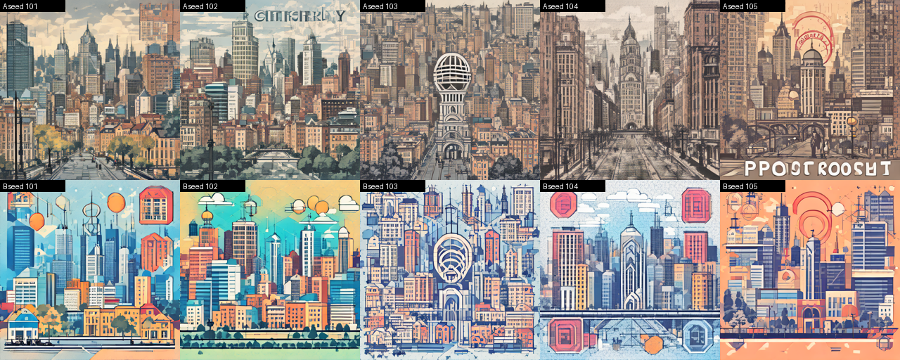

# Лабораторная работа №9

## Промпт-инжиниринг

**Дисциплина:** «Искусственный интеллект в креативных технологиях»  
**Вариант:** 7  
**Контекст:** №2 — обложка подкаста о городе  
**Элемент:** №1 — стилевая фраза `minimal flat geometric style`  
**Студент:** Провков Иван Александрович  
**Группа:** Т26ИИКТ-МИК11  
**Дата выполнения:** 06.11.2026

---

## 1. Цель, постановка, гипотеза и допуск

Цель работы — экспериментально проверить, как один добавленный элемент запроса меняет результат генератора изображений, и сравнить три приёма составления запроса к языковой модели по заранее заданной схеме ответа.

Вариант 7: контекст c = 2, элемент k = (7 − 1) mod 6 + 1 = 1.

**Часть 1.** SD Turbo, два запроса на одних и тех же seed 101…105; различается только стилевая фраза:

| | Режим A | Режим B |
| --- | --- | --- |
| Запрос | `podcast cover about the city` | `podcast cover about the city, minimal flat geometric style` |
| Шаги, guidance | 1; 0,0 | то же |
| Размер, тип, устройство | 512×512, `float32`, процессор | то же |

Метрики: `clip_target` — сходство изображения с текстом `minimal flat geometric style`; `clip_subject` — сходство с базовым запросом (контроль ухода от предмета); `edge` — плотность границ; `contrast` — контраст. Значения CLIP — косинусное сходство ×100.

**Часть 2.** Пять описаний заказчика на русском языке преобразуются в пять JSON-объектов для генератора изображений. Сравниваются три приёма: zero-shot, few-shot и пошаговые инструкции, по три повтора каждого.

### Гипотезы и допуск

Гипотезы и допуск записаны **до запуска**, 06.11.2026 в 16:35 ([журнал](journal.md)); ноутбук запущен в 17:13 по местному времени (14:13 UTC).

> **H1.** Стилевая фраза повысит `clip_target` сильнее, чем разброс между seed (Δ > 2s), и больше допуска 1,0.  
> **H2.** `clip_subject` не упадёт больше допуска 1,0.  
> **H3.** `edge` вырастет больше чем на 10 %; `contrast` изменится в пределах ±10 %.  
> **H4.** На изображениях B слои горизонта будут читаться как отдельные полосы чаще, чем на A.  
> **H5.** Все три приёма дадут K1, K2 и K3 не ниже 0,8.  
> **H6.** Наибольшую стабильность K4 даст few-shot, наименьшую — пошаговые инструкции.

| Метрика | Допуск | Обоснование |
| --- | --- | --- |
| `clip_target` | 1,0 пункта | образец методички; меньше 1 пункта не считаем заметным для выбора запроса |
| `clip_subject` | 1,0 пункта | образец методички; тревога — падение больше допуска |
| `edge` | 10 % от A | образец методички; тот же порог, что в ЛР06 и ЛР07 |
| `contrast` | 10 % от A | образец методички; тот же порог, что в ЛР06 и ЛР07 |

Отклик по каждой метрике относится к одному из классов: «значимо и практически важно» (|Δ| > 2s и больше допуска), «только значимо», «только практически важно», «ни то ни другое».

## 2. Данные, модели, лицензии и ограничения

Запросы части 1 заданы вариантом. Описания заказчика части 2 взяты из `lab09_llm.py` и являются учебными:

1. Обложка подкаста о городе: слоистый горизонт из геометрических фигур, бирюзовый и оранжевый цвета, минимализм, квадратный формат.
2. Обложка выпуска про ночной город: тёмное небо, огни окон, вид с крыши; оранжевого и янтарного в палитре быть не должно.
3. Обложка выпуска о велодорожках и общественном транспорте: яркая плоская иллюстрация, без людей.
4. Обложка выпуска о дворах и зелёных крышах: вид сверху, тёплое утро; палитра — ровно два цвета: зелёный и жёлтый.
5. Обложка выпуска о старом районе: кирпичные фасады, закатный свет, акварель.

Показатели части 2 (`lab09_llm.py`):

- **K1** — доля объектов из пяти, прошедших проверку схемы;
- **K2** — среднее покрытие смысловых элементов описания;
- **K3** — доля объектов, у которых список `avoid` в точности совпал с запретами описания;
- **K4** — совпадения полей `style` и `composition` по всем парам повторов и всем пяти объектам: 3 пары × 5 объектов × 2 поля = 30 сравнений.

| Источник | Происхождение | Условия |
| --- | --- | --- |
| SD Turbo, `stabilityai/sd-turbo` @ `b261bac6…` | Hugging Face | Stability AI Community License Agreement, учебное некоммерческое использование |
| CLIP ViT-L/14, `openai/clip-vit-large-patch14` @ `32bd6428…` | Hugging Face | по карточке модели на закреплённой ревизии |
| Perplexity, веб-версия | бесплатный аккаунт | условия сервиса нужно проверять перед использованием вне учебной работы |

В запросы к языковой модели персональные данные не вводились. Изображения синтетические и не являются фотографией города.

Ограничения: один контекст, один элемент, один прогон; s оценивается по пяти значениям режима A; сходство CLIP измеряет соответствие тексту, а не качество изображения.

## 3. Рабочая среда

| Параметр | Фактическое значение |
| --- | --- |
| Среда, устройство | Google Colab, процессор, GPU нет |
| Python | `3.13.18` |
| torch | `2.11.0+cpu` |
| diffusers / transformers | `0.42.1` / `5.22.0` |
| numpy / scipy / Pillow | `2.4.6` / `1.16.3` / `11.3.0` |
| Platform | `Linux-6.6.159+-x86_64-with-glibc2.39` |
| Время | загрузка SD Turbo 61,4 с, CLIP 25,5 с; демо 858,1 с; вариант 7 831,2 с; изображение в среднем 69,8 с |
| Языковая модель | Perplexity, режим по умолчанию; модель не выбиралась, список моделей закрыт на бесплатном тарифе; интерфейс не показывает её название; 06.11.2026 |

**Отклонения от методички.** Методичка называет средой части 1 Engee. Снимков консоли она не требует, поэтому работа выполнена в Google Colab на процессоре, как ЛР05–ЛР07; выполненный ноутбук фиксирует вывод ячеек. Версии библиотек Colab новее проверенных в методичке. Предустановленный `torchao` несовместим с установленной версией diffusers, поэтому первая ячейка удаляет его до импорта. Библиотеки преподавателя не менялись. Файл `lab09_llm.py` в архиве записан с окончаниями строк CRLF, а ячейка `%%writefile` записывает LF, поэтому сверяется хеш того же текста с LF (`8e9d3fb3…`). Полная фиксация — в [environment.txt](environment.txt).

## 4. Ход работы

1. Гипотезы, допуск и правила классификации записаны в журнал.
2. Ячейки `%%writefile` записывают `lab09_lib.py` и `lab09_llm.py`; SHA-256 сверяются (`cc4d233d…`, `8e9d3fb3…`).
3. Демонстрационный вариант 1 выполнен и сверен с таблицей методички.
4. Обязательный вызов методички для варианта 7. Обёртка над `L.measure` только запоминает значения по seed; вычисления библиотеки не меняются:

```python
metric_rows, per_seed_df, images, summary_seconds = run_variant(VARIANT)
```

5. Построены лист seed 101 и лист всех пяти seed, выполнена классификация и намеренная ошибка 1.
6. Запросы части 2 сформированы функцией `build_prompt` и сохранены в `prompts/`. Приёмы различаются одной вставкой: у few-shot — два примера формата для других описаний, у пошагового — просьба сначала выписать ключевые элементы, затем дать JSON.
7. Каждый из девяти запросов отправлен в новом чате; поиск отключён текстом запроса. Ответы сохранены без правок в `answers/` и оценены функциями `score_file` и `stability`.
8. Намеренная ошибка 2: запрос без закрытого списка цветов, ответ оценён по той же схеме; в девять зачётных ответов не входит.
9. Выполнение остановилось на итоговой проверке, пока `VISUAL_CHECK` не был заполнен. После просмотра листов заново выполнены только ячейки от визуальной проверки; изображения и метрики не пересчитывались. Паспорт получил статус `COMPLETE`.

## 5. Результаты

### 5.1. Таблица метрик (seed 101…105)

| Метрика | A | s | B | Δ | \|Δ\|/s | \|Δ\| > 2s |
| --- | ---: | ---: | ---: | ---: | ---: | :---: |
| `clip_target` | 10.728 | 2.232 | 14.937 | +4.210 | 1.89 | нет |
| `clip_subject` | 23.856 | 0.838 | 22.804 | −1.052 | 1.26 | нет |
| `edge` | 0.0607 | 0.0054 | 0.0675 | +0.0069 | 1.28 | нет |
| `contrast` | 0.1907 | 0.0150 | 0.2233 | +0.0326 | 2.17 | да |

Значения по каждому seed (A → B):

| seed | `clip_target` | `clip_subject` | `edge` | `contrast` |
| ---: | --- | --- | --- | --- |
| 101 | 14.62 → 14.39 | 23.10 → 22.19 | 0.0549 → 0.0632 | 0.192 → 0.213 |
| 102 | 9.82 → 16.77 | 25.26 → 22.08 | 0.0568 → 0.0623 | 0.212 → 0.232 |
| 103 | 10.51 → 13.42 | 23.90 → 24.39 | 0.0682 → 0.0916 | 0.171 → 0.235 |
| 104 | 9.56 → 15.41 | 23.42 → 23.41 | 0.0637 → 0.0701 | 0.194 → 0.230 |
| 105 | 9.14 → 14.70 | 23.60 → 21.95 | 0.0597 → 0.0504 | 0.185 → 0.207 |

`contrast` вырос на всех пяти seed, `clip_target` и `edge` — на четырёх из пяти, `clip_subject` снизился на четырёх из пяти (на seed 104 почти не изменился).

### 5.2. Лист сравнения




### 5.3. Визуальное описание

- **Режим A:** почти фотографические панорамы и улицы в перспективе; здания сливаются в плотную массу; отдельных полос нет ни на одном seed (0 из 5).
- **Режим B:** плоская стилизованная иллюстрация с чёткими цветовыми блоками; ярусы горизонта читаются на seed 101, 102, 104 и 105 (4 из 5); на seed 103 — плотный узор с круглой эмблемой в центре.
- **Стиль B не чистый минимализм:** много мелких деталей, круглые фигуры и вывески.
- **Артефакты:** буквоподобные надписи на A seed 102 и A seed 105, мелкие знаки внизу B seed 105, хотя текста в запросе не было.

### 5.4. Воспроизведение демонстрационного варианта

| Метрика | A | B | Δ | 2s | Методичка (A / B / Δ) |
| --- | ---: | ---: | ---: | :---: | --- |
| `clip_target` | 12.04 | 16.73 | +4.68 | нет | 12.10 / 16.71 / +4.61 |
| `clip_subject` | 25.22 | 25.64 | +0.42 | нет | 25.24 / 25.65 / +0.40 |
| `edge` | 0.0375 | 0.0443 | +0.0069 | да | 0.0375 / 0.0443 / +0.0069 |
| `contrast` | 0.1808 | 0.1734 | −0.0073 | нет | 0.1808 / 0.1734 / −0.0073 |

Все значения лежат в пределах 2s от методички, выводы по критерию 2s те же. `edge` и `contrast` совпали до четвёртого знака, значения CLIP отличаются на сотые; вероятная причина — более новая версия transformers, отдельно это не проверялось.

### 5.5. Часть 2: показатели K1–K4

| Приём | Повторов | K1 | K2 | K3 | K4 |
| --- | ---: | ---: | ---: | ---: | ---: |
| zero-shot | 3 | 1.000 | 1.000 | 1.000 | 0.933 |
| few-shot | 3 | 1.000 | 1.000 | 1.000 | 0.933 |
| пошаговые инструкции | 3 | 1.000 | 1.000 | 1.000 | 0.933 |

Значение K4 = 0,933 — это 28 совпадений из 30. У каждого приёма один повтор отличается в одном поле одного объекта:

| Приём | Объект | Поле | r1 | r2 | r3 |
| --- | ---: | --- | --- | --- | --- |
| zero-shot | 3 | `composition` | rule of thirds | rule of thirds | wide negative space |
| few-shot | 2 | `style` | flat vector illustration | photorealistic | photorealistic |
| пошаговые инструкции | 3 | `composition` | rule of thirds | wide negative space | rule of thirds |

В обоих объектах описание заказчика не задаёт поле, которое разошлось: для объекта 2 не назван стиль, для объекта 3 — композиция.

Запрос пошагового приёма просит сначала выписать ключевые элементы, но модель сделала это только в r3; в r1 и r2 ответ в чате сразу начинается с JSON. K1–K4 считаются по JSON и этого не замечают, поэтому пропуск шага на них не повлиял: приём фактически выполнен полностью лишь в одном повторе из трёх.

## 6. Анализ

### 6.1. Классификация и сверка с гипотезами

| Метрика | Δ | Допуск | \|Δ\| > 2s | Больше допуска | Класс |
| --- | ---: | ---: | :---: | :---: | --- |
| `clip_target` | +4.210 | 1,0 | нет | да | только практически важно |
| `clip_subject` | −1.052 | 1,0 | нет | да | только практически важно |
| `edge` | +11,31 % | 10 % | нет | да | только практически важно |
| `contrast` | +17,11 % | 10 % | да | да | значимо и практически важно |

- **H1 не подтверждена:** изменение больше допуска, но |Δ|/s = 1,89 меньше двух.
- **H2 не подтверждена, на грани:** падение −1,05 при допуске 1,0, причём по критерию 2s оно незначимо.
- **H3 подтверждена частично:** `edge` +11,31 % (больше 10 %), но `contrast` +17,11 % вышел за ±10 %. Ожидание по `contrast` опиралось на демо, где другой запрос дал −4 %.
- **H4 подтверждена по оценке глазами:** 0 из 5 на A и 4 из 5 на B.
- **H5 подтверждена:** K1 = K2 = K3 = 1,0 у всех приёмов.
- **H6 не подтверждена:** K4 одинаков у всех приёмов.

### 6.2. Статистическая значимость и практическая польза

По трём метрикам критерий 2s и допуск дают разный ответ: изменение больше допуска, но не выходит за 2s. Это не значит, что эффекта нет: разброс между seed велик и пять значений его оценивают грубо.

Показательно `clip_target`. Режим A на seed 101 дал 14,62, остальные четыре значения лежат в пределах 9,14–10,51. Один этот seed сильно увеличивает s: без него s режима A составил бы 0,57 вместо 2,23. Исключать seed после запуска нельзя, поэтому критерий не менялся и класс остаётся прежним; это наблюдение объясняет, почему Δ = +4,21 не прошло порог 2s. Почему именно на этом seed сходство высокое, отдельно не проверялось.

**Чувствительность к допуску.** При половинном допуске все четыре изменения остаются больше допуска. При двукратном допуске больше него остаётся только `clip_target`: `clip_subject` (1,05 против 2,0), `edge` (11,3 % против 20 %) и `contrast` (17,1 % против 20 %) в него укладываются, а `contrast` становится «только значимо». Устойчив лишь вывод о `clip_target`; остальные выводы зависят от выбора допуска, а падение `clip_subject` едва превысило порог.

### 6.3. Расхождение метрик и оценки глазами

- На seed 101 `clip_target` почти не изменился (14,62 → 14,39), хотя глазами разница очевидна: фотографическая панорама на A, плоская иллюстрация с ярусами на B. Здесь метрика не показала то, что видно на листе.
- На seed 103 `clip_target` вырос на 2,91, а ярусов нет: вместо горизонта — плотный узор с эмблемой. Рост метрики не гарантирует нужной композиции. На этом же seed `edge` вырос сильнее всего (+34 %) — узор даёт много границ.
- Рост `clip_target` не означает минимализма: у B много мелких деталей. CLIP сравнивает изображение с фразой в целом и не проверяет каждое её слово.
- Падение `clip_subject` глазами как уход от темы не читается: на всех изображениях это город. Метрика реагирует и на смену стиля, потому что базовый запрос не содержит стилевых слов; это объяснение отдельно не проверялось.

### 6.4. Наблюдение и объяснение

Наблюдения — разделы 5.1–5.3. Ниже — объяснения; отдельными экспериментами они не проверялись.

- **Рост `contrast` и `edge`.** Плоская иллюстрация состоит из заполненных цветовых блоков с резкими границами, а фотографические панорамы A — из плавных переходов и плотной массы зданий.
- **Рост `edge` неустойчив.** На seed 105 он снизился (0,0597 → 0,0504), а на seed 103 вырос на 34 %: величина изменения зависит от того, какое изображение получилось на конкретном seed.
- **Буквоподобные артефакты.** Слово `cover` может подталкивать модель к изображению надписей: на обложках обычно есть текст. Проверить это можно было бы отдельным запросом без этого слова, в данной работе это не сделано.

### 6.5. Часть 2: сравнение приёмов

K1–K3 упёрлись в потолок: схема, закрытые списки и запреты полностью заданы в запросе, поэтому эти показатели не различают приёмы. Различить их мог бы только K4, но он одинаков.

Окончательный вывод о приёмах из этих данных сделать нельзя. У K4 всего 3 повтора и 30 сравнений, и они не независимы: одно изменившееся значение в одном повторе меняет сразу две пары из трёх, то есть K4 на 2/30 = 0,067. В образце методички значения K4 другие (zero 0,767; few 0,933; step 0,500), что показывает, насколько велик разброс на таких выборках. Режим модели тоже неизвестен: в режиме по умолчанию сервис мог обрабатывать запросы разными моделями.

Сравнение пошагового приёма ограничено ещё и тем, что модель выполнила шаг с ключевыми элементами только в одном повторе из трёх (раздел 5.5). Показатели этого не видят: они проверяют итоговый JSON, а не следование инструкции.

Расхождения пришлись только на поля, которые описание заказчика не задаёт (раздел 5.5). Практический вывод осторожный: то, что важно заказчику, нужно задавать явно, а не надеяться на стабильность приёма.

### 6.6. Намеренные ошибки

**Ошибка 1: вывод по одному seed.**

| seed | 101 | 102 | 103 | 104 | 105 |
| --- | ---: | ---: | ---: | ---: | ---: |
| Δ `clip_target` | −0.23 | +6.96 | +2.91 | +5.85 | +5.56 |

**Симптом.** По seed 101 вывод был бы «фраза не работает», по seed 102 — «сильный эффект». **Диагностика.** Разброс разностей (от −0,23 до +6,96) больше среднего эффекта. **Исправление.** Пять seed, среднее, s и критерий 2s.

**Ошибка 2: проверка по правилу, которого нет в запросе.** Из запроса убран закрытый список цветов, а проверка осталась прежней.

| Запрос | K1 | K2 | K3 | Нарушения |
| --- | ---: | ---: | ---: | --- |
| без списка цветов | 0.4 | 1.0 | 1.0 | объект 1: turquoise; объект 2: navy blue, cool white, cyan; объект 5: brick red, gold, ochre |
| со списком цветов (zero-shot) | 1.0 | 1.0 | 1.0 | нет |

**Симптом.** K1 падает с 1,0 до 0,4. **Диагностика.** Цвета в ответе разумные и соответствуют описаниям; модель не нарушила запрос, а проверка измеряет правило, которого в запросе не было. **Исправление.** Вернуть закрытый список цветов в запрос; K1 возвращается к 1,0.

### 6.7. Угрозы валидности

- Один контекст, один элемент, один прогон; s оценён по пяти значениям и чувствителен к отдельным seed.
- CLIP измеряет соответствие тексту, а не качество; сходство зависит от модели CLIP и формулировки текста-цели.
- `edge` и `contrast` описывают изображение в целом и не видят композицию.
- Визуальную проверку выполнял один человек, критерий «читаются как полосы» субъективен.
- Версии библиотек новее проверенных в методичке; демо сошлось, но значения CLIP отличаются на сотые.
- Часть 2: один сервис, одна дата, бесплатный аккаунт, модель неизвестна, три повтора. Поиск отключён только текстом запроса; проверить, что сервис его не использовал, можно лишь по отсутствию ссылок в ответах.
- Ответы копировались вручную; K2 считает покрытие смысловых элементов по правилам библиотеки и не оценивает смысл ответа целиком.

## 7. Вывод

Добавление стилевой фразы `minimal flat geometric style` к запросу `podcast cover about the city`:

- повысило `clip_target` на 4,21 (с 10,73 до 14,94) — больше допуска, но |Δ|/s = 1,89, порог 2s не пройден;
- снизило `clip_subject` на 1,05 — на грани допуска, незначимо по 2s;
- повысило `edge` на 11,31 % — больше допуска, незначимо по 2s;
- повысило `contrast` на 17,11 % — единственное изменение, значимое и практически важное;
- заметно изменило изображения: ярусы горизонта на 4 из 5 seed против 0 из 5, плоский стиль вместо почти фотографического, но без чистого минимализма.

Для этой обложки фразу стоит использовать: вид меняется в нужную сторону, но результат нужно просматривать по нескольким seed. На одном seed из пяти ярусов нет, а лишние буквоподобные знаки встречаются в обоих режимах (A seed 102 и 105, B seed 105). Вывод основан на просмотре листов и метриках вместе; одними метриками он не обосновывается.

В части 2 три приёма дали одинаковые значения: K1 = K2 = K3 = 1,0 (потолок) и K4 = 0,933. Вывод предварительный: сервис Perplexity, режим по умолчанию, модель неизвестна, 06.11.2026, три повтора на приём, 30 сравнений K4 на приём, и они не независимы. Различие приёмов на этих данных не обнаружено, но и равенство не доказано.

Выводы относятся к SD Turbo на закреплённой ревизии, 1 шагу, размеру 512×512, seed 101…105 и контексту «обложка подкаста о городе» и не переносятся на другие модели и контексты без проверки.

## 8. Файлы, паспорт и ссылки

- [Ноутбук с выводами](../lab09.ipynb)
- Библиотеки без изменений: [lab09_lib.py](../src/lab09_lib.py), [lab09_llm.py](../src/lab09_llm.py)
- [Паспорт эксперимента](../artifacts/passport.json) — статус `COMPLETE`, версии среды, параметры, режим модели и дата
- [Таблица метрик](../artifacts/metrics.json), [значения по seed](../artifacts/per_seed_metrics.csv), [классификация](../artifacts/classification.json)
- [Лист seed 101](../artifacts/comparison.png), [лист пяти seed](../artifacts/comparison_all_seeds.png), [воспроизведение демо](../artifacts/demo/demo_variant01.json)
- [Запросы](../prompts/), [ответы без правок](../answers/), [показатели K1–K4](../artifacts/part2_scores.json), [намеренные ошибки](../artifacts/intentional_error.json)
- [Параметры варианта](../configs/run_config.json), [сведения о языковой модели](../configs/llm_info.json), [журнал](journal.md), [среда](environment.txt), [подготовка к защите](defense.md)

Корень репозитория: [github.com/oneway192/ai-in-ci](https://github.com/oneway192/ai-in-ci).

## 9. Индивидуальный вклад

Студент:

- записал гипотезы, допуск и правила классификации до запуска;
- выполнил ноутбук в Google Colab, воспроизвёл демонстрационный вариант и сверил его с методичкой;
- выполнил вариант 7 и провёл визуальную проверку по листам;
- отправил запросы части 2 в отдельных чатах, сохранил ответы без правок и зафиксировал режим модели и дату;
- воспроизвёл обе намеренные ошибки и проанализировал расхождение критерия 2s, допуска и оценки глазами.
