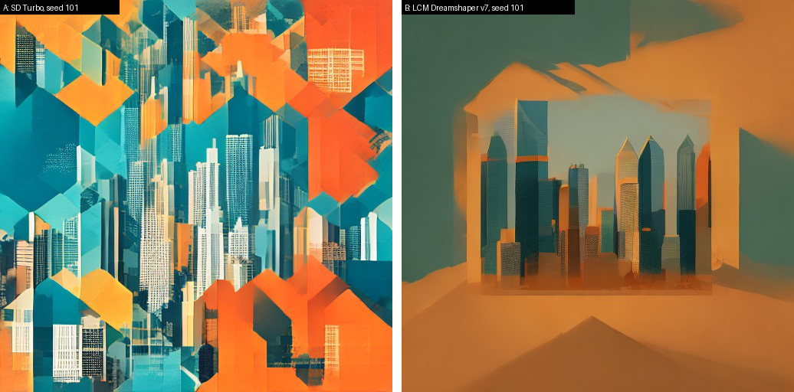
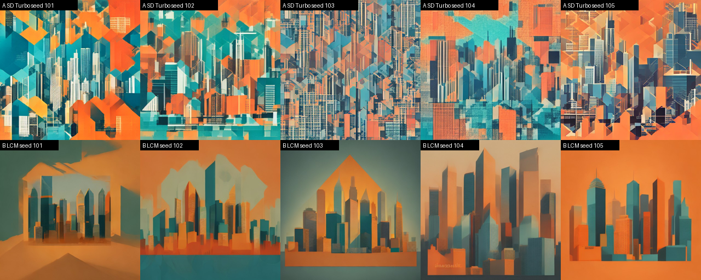

# ЛР №10. Сравнительное исследование моделей text-to-image

**Вариант 7:** бриф 2 — обложка подкаста о городе; пара 1 — SD Turbo (модель A) и LCM Dreamshaper v7 (модель B); seed 101…105.

Цель работы — сравнить две модели text-to-image по протоколу, при котором различие вызвано моделью, а не условиями запуска: один бриф, одни seed, каждая модель в своей конфигурации, разброс по seed, время без загрузки, слепая оценка глазами.

| Параметр | Фактическое значение |
| --- | --- |
| Модель A | `stabilityai/sd-turbo` @ `b261bac6…`, 1 шаг, guidance 0,0, 512×512 |
| Модель B | `SimianLuo/LCM_Dreamshaper_v7` @ `a85df6a8…`, 4 шага, guidance 8,0, 512×512 |
| Бриф | `square podcast cover about the city environment, abstract layered skyline of geometric shapes, teal and orange palette, minimal flat style, no text, no people` |
| Метрики | `clip_brief`, `clip_text` (CLIP ViT-L/14), `edge`, `contrast`, `seconds` |
| Среда | Google Colab, процессор, 1 поток, Python 3.13.18 |
| Библиотеки | torch 2.14.1+cpu; diffusers 0.32.2; transformers 4.57.6 (раздел 4 методички) |
| Итог | `clip_brief` у LCM выше на всех seed, но не значимо по 2s; `edge` −78 % и `contrast` −26 % значимы; LCM медленнее в 1,59 раза; слепой счёт 3:2 в пользу LCM, p = 1,0 |

## Результат

| Метрика | A: SD Turbo | s | B: LCM | Δ | \|Δ\|/s | 2s | Класс |
| --- | ---: | ---: | ---: | ---: | ---: | :---: | --- |
| `clip_brief` | 30.951 | 1.705 | 32.634 | +1.683 | 0.99 | нет | только практически важно |
| `clip_text` | 14.163 | 0.448 | 14.639 | +0.476 | 1.06 | нет | ни то ни другое |
| `edge` | 0.0489 | 0.0109 | 0.0108 | −0.0381 (−77,95 %) | 3.50 | да | значимо и практически важно |
| `contrast` | 0.1585 | 0.0175 | 0.1174 | −0.0411 (−25,94 %) | 2.35 | да | значимо и практически важно |
| `seconds` | 81.7 | 8.0 | 129.7 | +48.0 (×1,59) | 6.02 | да | значимо и практически важно |

- Слои горизонта читаются у LCM на 4 seed из 5, у SD Turbo — ни разу: у него плотная мозаика из геометрических фрагментов.
- Слепая оценка до открытия ключа: LCM выбран в 3 парах из 5; пять пар не дают оснований для вывода на уровне 0,05.
- `clip_text` не нашёл буквоподобную надпись на LCM seed 104 — она видна только глазами.
- Намеренная ошибка 2 (LCM с одним шагом) меняет знак разности по `clip_brief` и убирает разницу во времени.
- Демонстрационный вариант 1 воспроизведён: `edge` и `contrast` совпали с методичкой до четвёртого знака, `clip_brief` — в пределах 0,04.

## Как повторить

1. Открыть [lab10.ipynb](lab10.ipynb) в Google Colab, среда без GPU (библиотека считает на процессоре). Методичка называет средой Engee, работа выполнена в Colab.
2. «Среда выполнения → Выполнить все». Первая ячейка ставит `diffusers==0.32.2` и `transformers<5`, удаляет неиспользуемый `torchao`; ячейка `%%writefile` записывает `lab10_lib.py` и сверяет SHA-256. Затем вариант 7, намеренная ошибка 2 (LCM с одним шагом) и демо-вариант 1 — на процессоре Colab около 70 минут.
3. Выполнение остановится на ячейке ключа слепого сравнения. По пяти листам без подписей заполнить `BLIND_CHOICES`, `BLIND_EVALUATOR` и `BLIND_CHOICE_RECORDED_AT`, затем выполнить ячейки с этой и ниже; пересчёт не нужен.
4. После просмотра листов с подписями заполнить `VISUAL_CHECK` и выполнить ячейки до конца; последняя скачивает архив результатов.

## Что где лежит

| Файл или каталог | Содержание |
| --- | --- |
| [lab10.ipynb](lab10.ipynb) | выполненный notebook с outputs |
| [src/lab10_lib.py](src/lab10_lib.py) | библиотека из приложения А методички без изменений (архива с файлом нет; посимвольная сверка с PDF совпала) |
| [configs/run_config.json](configs/run_config.json) | параметры варианта, конфигурации моделей, допуски |
| [artifacts/metrics.json](artifacts/metrics.json), [artifacts/per_seed_metrics.csv](artifacts/per_seed_metrics.csv) | таблица `variant_summary` и значения по seed |
| [artifacts/classification.json](artifacts/classification.json) | классификация по 2s и допуску, чувствительность к допуску |
| [artifacts/v07/](artifacts/v07/) | десять изображений варианта, листы `blind_<seed>.png` и ключ `blind_key.json` |
| [artifacts/blind_result.json](artifacts/blind_result.json) | выбор до ключа, причины, победы модели B, вероятность |
| [artifacts/comparison_seed101.png](artifacts/comparison_seed101.png), [artifacts/comparison_all_seeds.png](artifacts/comparison_all_seeds.png) | лист seed 101 и лист пяти seed |
| [artifacts/intentional_errors.json](artifacts/intentional_errors.json), [artifacts/error_lcm_1step/](artifacts/error_lcm_1step/), [artifacts/v07_err/](artifacts/v07_err/), [artifacts/error_lcm_1step.png](artifacts/error_lcm_1step.png) | три намеренные ошибки и прогон LCM с одним шагом |
| [artifacts/demo/](artifacts/demo/) | воспроизведение демо-варианта и сверка с методичкой |
| [artifacts/passport.json](artifacts/passport.json) | паспорт эксперимента со статусом `COMPLETE` |
| [reports/report.md](reports/report.md) | полный отчёт; [PDF](reports/report.pdf) и [DOCX](reports/report.docx) — для сдачи |
| [reports/journal.md](reports/journal.md) | журнал: гипотезы до запуска, прогон, результаты |
| [reports/environment.txt](reports/environment.txt) | фактическая среда |
| [reports/defense.md](reports/defense.md) | ответы на контрольные вопросы |
