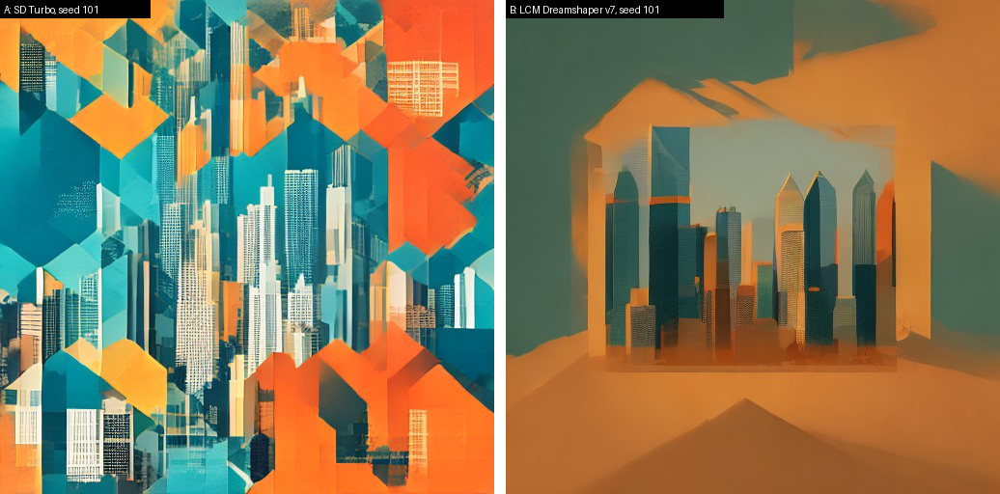
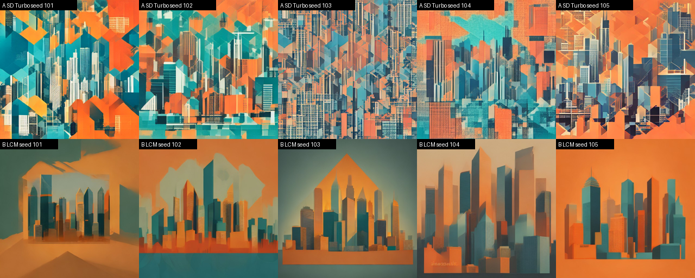
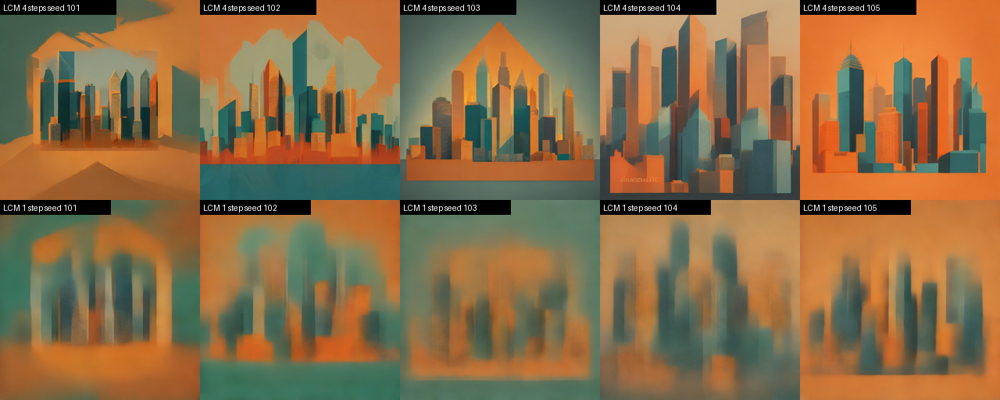

# Лабораторная работа №10

## Сравнительное исследование моделей text-to-image

**Дисциплина:** «Искусственный интеллект в креативных технологиях»  
**Вариант:** 7  
**Бриф:** №2 — обложка подкаста о городе  
**Пара моделей:** №1 — SD Turbo (модель A) и LCM Dreamshaper v7 (модель B)  
**Студент:** Провков Иван Александрович  
**Группа:** Т26ИИКТ-МИК11  
**Дата выполнения:** 12.11.2026

---

## 1. Цель, постановка, гипотеза и допуск

Цель работы — сравнить две модели text-to-image по протоколу, при котором различие вызвано моделью, а не условиями запуска. Бриф и seed одинаковы, каждая модель работает в своей заданной конфигурации, разброс оценивается по пяти seed, время измеряется без загрузки весов, изображения дополнительно оцениваются вслепую.

Вариант 7: бриф c = ceil(7/6) = 2, пара k = ((7 − 1) mod 6) + 1 = 1.

| | Модель A | Модель B |
| --- | --- | --- |
| Модель | SD Turbo | LCM Dreamshaper v7 |
| Репозиторий и ревизия | `stabilityai/sd-turbo` @ `b261bac6…` | `SimianLuo/LCM_Dreamshaper_v7` @ `a85df6a8…` |
| Семейство | дистиллированная SD 2.1 (состязательная дистилляция) | модель согласованности в латентном пространстве |
| Шаги, guidance | 1; 0,0 | 4; 8,0 |
| Размер кадра | 512×512 | 512×512 |
| Планировщик | из репозитория (Euler) | из репозитория (LCM) |

Одинаковыми для обеих моделей остаются бриф, seed 101…105, генератор `torch.Generator("cpu")`, тип `float32`, число потоков и метрики. Конфигурации взяты из таблицы 2.2 методички и не менялись; они входят в сравниваемый объект.

Метрики: `clip_brief` — сходство изображения с текстом брифа в CLIP ViT-L/14 (косинус ×100, не CLIPScore); `clip_text` — сходство с пробой `written text and letters` (меньше — лучше); `edge` — средняя длина градиента яркости изображения, приведённого к 256×256; `contrast` — стандартное отклонение яркости 256×256; `seconds` — время одного вызова генерации без загрузки весов, после прогревочного вызова.

### Гипотезы и допуск

Гипотезы и допуск записаны **до запуска**, 12.11.2026 в 11:24 МСК ([журнал](journal.md)); ноутбук в Colab запущен в 11:43 МСК (08:43 UTC).

> **H1** (гипотеза варианта). LCM ближе к брифу, чем SD Turbo: `clip_brief` B выше A больше чем на 2s и больше допуска 1,0.  
> **H2.** LCM медленнее SD Turbo примерно вдвое: отношение времени B/A не меньше 1,5.  
> **H3.** `clip_text` различается не больше допуска 1,0.  
> **H4.** `edge` и `contrast` различаются не больше чем на 10 % от A.  
> **H5.** В слепой оценке LCM выбран не менее чем в 3 парах из 5.  
> **H6.** Слои горизонта читаются как отдельные бирюзовые и оранжевые геометрические полосы у каждой модели не менее чем на 3 seed из 5.

| Метрика | Допуск | Обоснование |
| --- | --- | --- |
| `clip_brief` | 1,0 пункта | образец методички; меньше 1 пункта не считаем заметным для выбора модели |
| `clip_text` | 1,0 пункта | образец методички; тревога — рост больше допуска |
| `edge` | 10 % от A | образец методички; тот же порог, что в ЛР06–ЛР09 |
| `contrast` | 10 % от A | образец методички |
| `seconds` | отношение 1,5 | образец методички |

Значимость — признак |Δ| > 2s, где s — выборочное стандартное отклонение модели A по пяти seed. Каждая метрика относится к одному классу: «значимо и практически важно», «только значимо», «только практически важно», «ни то ни другое». Методичка (шаг 7) называет три класса — «значимо по 2s», «важно на практике», «ни то ни другое»; здесь случай, когда выполнены оба условия, выделен в отдельный класс, чтобы не относить такую метрику только к одному из них. Сами признаки |Δ| > 2s и «больше допуска» приведены в таблице 6.1 отдельно.

## 2. Данные, модели, лицензии

Бриф 2 (приложение Б методички, синтетический, свободный): `square podcast cover about the city environment, abstract layered skyline of geometric shapes, teal and orange palette, minimal flat style, no text, no people`.

| Источник | Происхождение | Лицензия (метаданные Hugging Face, проверено 12.11.2026) |
| --- | --- | --- |
| SD Turbo, `stabilityai/sd-turbo` @ `b261bac6fd2c…` | Hugging Face, закреплённая ревизия | в метаданных не указана; условия Stability AI Community License по карточке модели, учебное некоммерческое использование |
| LCM Dreamshaper v7, `SimianLuo/LCM_Dreamshaper_v7` @ `a85df6a8bd97…` | Hugging Face, закреплённая ревизия | MIT |
| CLIP ViT-L/14, `openai/clip-vit-large-patch14` @ `32bd64288804…` | Hugging Face, закреплённая ревизия | в метаданных не указана; условия по карточке модели (исследовательское использование) |

Закреплённые ревизии совпадают с текущими ревизиями репозиториев на дату проверки. Изображения синтетические, учебные и не выдаются за фотографию реального города; узнаваемых зданий и людей в брифе нет. Вне работы изображения не публикуются без проверки условий лицензий.

## 3. Рабочая среда

| Параметр | Фактическое значение |
| --- | --- |
| Среда, устройство | Google Colab, процессор, GPU нет; 2 vCPU, 12,7 ГБ ОЗУ |
| Потоки PyTorch | 1 (библиотека задаёт `min(4, torch.get_num_threads())`, PyTorch в Colab видит одно ядро) |
| Python | `3.13.18` |
| torch | `2.14.1+cpu` (из образа Colab, не менялся) |
| diffusers / transformers | `0.32.2` / `4.57.6` (команда раздела 4 методички) |
| huggingface_hub / numpy / scipy / Pillow | `0.36.2` / `2.4.6` / `1.16.3` / `11.3.0` |
| Platform | `Linux-6.6.159+-x86_64-with-glibc2.39` |
| Пик памяти процесса | 7,45 ГБ (вариант 7), 7,9 ГБ за весь сеанс |
| Время вызовов | вариант 7 — 1545,9 с; ошибка 2 — 1067,6 с; демо — 1363,1 с |
| Загрузка (первый вызов `variant_summary`, со скачиванием) | CLIP 35,4 с, SD Turbo 94,2 с, LCM 45,4 с; в следующих вызовах — 1,3–2,2 с из кэша |

**Отклонения от методички.** Методичка называет средой Engee; критерии оценивания платформу не задают, поэтому работа выполнена в Google Colab на процессоре, как ЛР05–ЛР09. Версии diffusers и transformers поставлены командой раздела 4 (`"diffusers==0.32.2" "transformers<5"`) и совпали с проверенными в методичке; PyTorch остался из образа Colab (2.14.1 вместо 2.4.1). Предустановленный `torchao` библиотекой не используется и мешает импорту diffusers, поэтому первая ячейка удаляет его до импорта. В Colab библиотека работает в одном потоке, а не в четырёх, поэтому время в секундах с Engee не сопоставляется; сравниваются только отношения внутри одного запуска. Архива работы с `lab10_lib.py` не было: библиотека перенесена из приложения А методички без изменений, посимвольная сверка с текстом PDF совпала, ноутбук сверяет SHA-256 (`b53293eb…`). Полная фиксация — в [environment.txt](environment.txt).

## 4. Ход работы

1. Гипотезы, допуск и правила классификации записаны в журнал до запуска.
2. Первая ячейка ставит версии раздела 4 методички; ячейка `%%writefile` записывает `lab10_lib.py`, SHA-256 сверяется.
3. Обязательный вызов методички для варианта 7. Обёртка над `L.measure`, `L.load_model` и `L.load_clip` только запоминает значения по seed и время загрузок; вычисления библиотеки не меняются:

```python
run_v07 = run_variant(VARIANT, artifacts / "v07")   # внутри: L.variant_summary(7, save_dir="artifacts/v07")
```

4. Классификация по 2s и допуску, чувствительность к допуску ×0,5 и ×2.
5. Намеренная ошибка 2: `L.variant_summary(7, save_dir="v07_err", cfg={"lcm": {"steps": 1}})`.
6. Демонстрационный вариант 1 (`L.variant_summary(1, save_dir="v01")`) и сверка с таблицей 6.3 методички; намеренная ошибка 3 по времени трёх вызовов.
7. `L.blind_sheets(7, "v07")` — пять листов без подписей; ключ не выводился. Выбор по каждому seed записан в ячейку `BLIND_CHOICES` в 12:57 МСК; ячейка ключа не выполняется, пока выбор не записан. Затем открыт ключ.
8. Только после этого построены и просмотрены листы с подписями моделей и заполнен `VISUAL_CHECK`.
9. Паспорт получил статус `COMPLETE`, итоговая проверка файлов и чек-листа методички пройдена.

## 5. Результаты

### 5.1. Таблица метрик (бриф 2, seed 101…105)

| Метрика | A: SD Turbo | s | B: LCM | Δ | \|Δ\|/s | \|Δ\| > 2s |
| --- | ---: | ---: | ---: | ---: | ---: | :---: |
| `clip_brief` | 30.951 | 1.705 | 32.634 | +1.683 | 0.99 | нет |
| `clip_text` | 14.163 | 0.448 | 14.639 | +0.476 | 1.06 | нет |
| `edge` | 0.0489 | 0.0109 | 0.0108 | −0.0381 (−77,95 %) | 3.50 | да |
| `contrast` | 0.1585 | 0.0175 | 0.1174 | −0.0411 (−25,94 %) | 2.35 | да |
| `seconds` | 81.7 | 8.0 | 129.7 | +48.0 (×1,59) | 6.02 | да |

Значения по каждому seed (A → B):

| seed | `clip_brief` | `clip_text` | `edge` | `contrast` | `seconds` |
| ---: | --- | --- | --- | --- | --- |
| 101 | 31.75 → 32.45 | 14.82 → 15.96 | 0.0448 → 0.0103 | 0.181 → 0.108 | 74.9 → 125.0 |
| 102 | 31.05 → 32.73 | 13.59 → 14.92 | 0.0446 → 0.0104 | 0.162 → 0.117 | 76.0 → 126.3 |
| 103 | 28.23 → 31.87 | 14.11 → 13.72 | 0.0682 → 0.0108 | 0.143 → 0.098 | 77.2 → 136.5 |
| 104 | 30.88 → 32.22 | 14.02 → 14.75 | 0.0417 → 0.0128 | 0.139 → 0.157 | 87.5 → 136.2 |
| 105 | 32.85 → 33.90 | 14.28 → 13.85 | 0.0449 → 0.0096 | 0.168 → 0.107 | 92.7 → 124.3 |

`clip_brief` у LCM выше на всех пяти seed, `edge` ниже на всех пяти, `contrast` ниже на четырёх (на seed 104 выше), `clip_text` выше на трёх.

### 5.2. Лист сравнения





### 5.3. Описание изображений

- **Seed 101.** A — плотная мозаика из бирюзовых и оранжевых шестиугольных и угловатых плоскостей с вкраплениями почти фотографических небоскрёбов: цвета брифа есть, единого горизонта и минимализма нет. B — мягкий, размытый горизонт бирюзовых башен в прямоугольной рамке на оранжевом фоне с треугольным холмом: палитра совпадает, композиция центрирована, но края смазаны, плоского геометрического стиля нет. Буквоподобных знаков и людей нет ни на одном.
- **SD Turbo на всех пяти seed** даёт перегруженную мозаику из геометрических фрагментов и окон; горизонт как последовательность слоёв не читается (0 из 5).
- **LCM на seed 102–105** даёт слоистый горизонт прямоугольных башен в бирюзово-оранжевой палитре, ближе к минимализму (4 из 5); на seed 101 горизонт размыт и заключён в рамку. Края мягкие, с дымкой, плоского стиля в строгом смысле нет.
- **Дефекты.** На LCM seed 104 внизу слева буквоподобная надпись, хотя текст запрещён брифом. Узнаваемых зданий и людей нет ни у одной модели.

### 5.4. Слепое сравнение

Пять листов `blind_<seed>.png` просмотрены до открытия ключа; критерий — соответствие брифу. Выбор и причины записаны в 12:57 МСК, ключ открыт после этого.

| seed | слева (по ключу) | выбор | выбрана модель | причина (записана до ключа) |
| ---: | --- | --- | --- | --- |
| 101 | SD Turbo | слева | SD Turbo | слева абстрактные геометрические плоскости в бирюзовом и оранжевом, хоть и перегруженные; справа размытый живописный горизонт в рамке без плоского геометрического стиля |
| 102 | SD Turbo | справа | LCM | справа читаемый слоистый горизонт из прямоугольных башен и спокойная композиция; слева плотный коллаж, в котором горизонт теряется |
| 103 | LCM | слева | LCM | слева минималистичный слоистый горизонт на фоне оранжевого треугольника; справа плотная мозаика без читаемого горизонта |
| 104 | SD Turbo | слева | SD Turbo | пограничный случай: справа чистый слоистый горизонт, но внизу буквоподобная надпись, запрещённая брифом; слева без текста, хотя перегружено |
| 105 | LCM | слева | LCM | слева минималистичный горизонт бирюзовых и оранжевых башен; справа плотная мозаика |

**Итог:** LCM (модель B) выбран в 3 парах из 5, SD Turbo — в 2. Двусторонняя вероятность исхода не менее экстремального, чем 3:2, при равенстве моделей равна 1,0; даже счёт 5:0 дал бы 2·(1/2)^5 = 0,0625 > 0,05. Пять пар не дают оснований для вывода на уровне 0,05; итог записывается как наблюдение.

### 5.5. Время

| | SD Turbo | LCM | Отношение B/A |
| --- | ---: | ---: | ---: |
| Вариант 7 (один вызов `variant_summary`) | 81,7 с (s = 8,0) | 129,7 с | 1,59 |
| Демо-вариант 1 (другой вызов того же сеанса) | 77,9 с | 131,5 с | 1,69 |

Время — одного вызова генерации после прогрева, без загрузки весов, на процессоре Colab в одном потоке. В методичке (Engee, 4 потока) отношение для этой пары — 1,73–1,90; абсолютные секунды с Engee не сопоставляются.

### 5.6. Воспроизведение демонстрационного варианта

| Метрика | A | B | Δ | 2s | Методичка (A / B / Δ) |
| --- | ---: | ---: | ---: | :---: | --- |
| `clip_brief` | 25.16 | 25.72 | +0.57 | нет | 25.17 / 25.73 / +0.56 |
| `clip_text` | 12.40 | 15.40 | +3.00 | да | 12.40 / 15.40 / +3.00 |
| `edge` | 0.0527 | 0.0112 | −0.0414 | да | 0.0527 / 0.0112 / −0.0414 |
| `contrast` | 0.1750 | 0.1503 | −0.0247 | нет | 0.1750 / 0.1503 / −0.0247 |
| `seconds` | 77.9 | 131.5 | +53.6 | да | 21.0 / 36.8 / +15.8 (Engee) |

Все значения A и B лежат в пределах 2s от методички, выводы по критерию 2s совпали. `edge` и `contrast` совпали до четвёртого знака, `clip_brief` по seed отличается не больше чем на 0,04 (SD Turbo: 24.47, 26.12, 24.20, 25.52, 25.47; методичка: 24.46, 26.13, 24.21, 25.53, 25.50). Результат методички повторён на другой платформе и с другой версией PyTorch.

## 6. Анализ

### 6.1. Классификация и сверка с гипотезами

| Метрика | Изменение | Допуск | \|Δ\| > 2s | Больше допуска | Класс | ×0,5 / ×2 |
| --- | ---: | ---: | :---: | :---: | --- | --- |
| `clip_brief` | +1.683 | 1,0 | нет | да | только практически важно | да / нет |
| `clip_text` | +0.476 | 1,0 | нет | нет | ни то ни другое | нет / нет |
| `edge` | −77,95 % | 10 % | да | да | значимо и практически важно | да / да |
| `contrast` | −25,94 % | 10 % | да | да | значимо и практически важно | да / да |
| `seconds` | ×1,59 | ×1,5 | да | да | значимо и практически важно | да / нет |

| Гипотеза | Результат | Оценка |
| --- | --- | --- |
| H1: `clip_brief` LCM выше больше чем на 2s и больше 1,0 | Δ = +1,68, \|Δ\|/s = 0,99 | не подтверждена: больше допуска, но не значимо по 2s |
| H2: отношение времени не меньше 1,5 | 1,59 | подтверждена, но не «вдвое» |
| H3: `clip_text` различается не больше 1,0 | Δ = +0,48 | подтверждена |
| H4: `edge` и `contrast` в пределах 10 % | −77,95 % и −25,94 %, оба значимы | не подтверждена |
| H5: LCM выбран не менее чем в 3 парах из 5 | 3 из 5, p = 1,0 | формально подтверждена, без статистического веса |
| H6: полосы горизонта у каждой модели ≥ 3 из 5 | SD Turbo 0 из 5, LCM 4 из 5 | не подтверждена |

### 6.2. Статистическая значимость и практическая польза

По `clip_brief` критерий 2s и допуск расходятся: разность +1,68 больше допуска 1,0, но |Δ|/s = 0,99. При этом LCM выше на всех пяти seed. Разброс s модели A завышает один seed: на seed 103 SD Turbo дал 28,23 при остальных значениях 30,88–32,85; без него s было бы 0,90 вместо 1,71. Исключать seed после запуска нельзя, класс остаётся «только практически важно». Это тот случай, о котором предупреждает раздел 2.4 методички: признак 2s консервативен и при пяти seed часто не срабатывает у небольшого, но устойчивого различия. Для справки, вне протокола методички: парный критерий по разностям на одних и тех же seed (t = 3,27, 4 степени свободы) дал бы p ≈ 0,03, а знаковый критерий для 5 из 5 — p = 0,0625. Вывод о `clip_brief` поэтому осторожный: LCM, вероятно, немного ближе к брифу по CLIP, но по принятому критерию это не доказано.

`edge` и `contrast` различаются устойчиво: класс не меняется ни при половинном, ни при двукратном допуске. Время: отношение 1,59 значимо и больше допуска, но при двукратном допуске (отношение 2,0) уже не было бы практически важным — гипотеза «примерно вдвое» в Colab не подтвердилась.

### 6.3. Расхождение метрики и глаза

- **`clip_brief` и слепая оценка.** CLIP ставит LCM выше на всех пяти seed, а при слепом выборе LCM выиграл только 3:2. CLIP видит соответствие тексту в целом («skyline», палитра) и слабо различает стиль: размытый горизонт в рамке (LCM seed 101) он оценил выше геометрической мозаики, хотя бриф просит «geometric shapes, minimal flat style».
- **`clip_text` не детектор текста.** Наибольшее значение у LCM seed 101 (15,96), где букв не видно, а на LCM seed 104 с буквоподобной надписью — 14,75, ниже, чем на seed 101 и 102. Проба реагирует на сходство с абстрактным «текстом», а не находит надписи; запрещённый текст нашёлся только глазами.
- **`edge` −78 %** соответствует увиденному: SD Turbo даёт мозаику из множества мелких фрагментов, LCM — гладкие крупные формы с мягкими краями. Плотность деталей — свойство конфигурации SD Turbo на этом брифе, а не признак «лучше» или «хуже».
- **`contrast` −26 %**: LCM приглушает изображение дымкой и тёплым фоном. На seed 104, где у LCM чёткие башни на светлом фоне, контраст выше, чем у SD Turbo.
- **Композиция** — главное различие на глаз (слои горизонта 0 из 5 против 4 из 5) — ни одной метрикой напрямую не измеряется.

### 6.4. Время и качество

LCM тратит на изображение в 1,59 раза больше времени (129,7 против 81,7 с в одном запуске). За это он даёт читаемый слоистый горизонт на 4 seed из 5 и `clip_brief` выше на 1,68 (больше допуска, но не значимо по 2s); при слепом выборе преимущество 3:2 статистически ничего не значит. На этом брифе дополнительное время LCM оправдано, если для обложки важна читаемая композиция горизонта; если важна скорость, а композицию можно добрать выбором seed, SD Turbo достаточен. Вывод относится только к брифу 2 и этим конфигурациям.

### 6.5. Намеренные ошибки

**Ошибка 1: вывод по одному seed.**

| seed | 101 | 102 | 103 | 104 | 105 |
| --- | ---: | ---: | ---: | ---: | ---: |
| Δ `clip_brief` (B − A) | +0.70 | +1.68 | +3.64 | +1.35 | +1.05 |
| \|Δ\|/s | 0.41 | 0.99 | 2.13 | 0.79 | 0.62 |

**Симптом.** По seed 103 вывод был бы «LCM значимо ближе к брифу» (|Δ| > 2s), по seed 101 — «модели не различаются» (Δ меньше допуска). **Диагностика.** Разность от +0,70 до +3,64 при среднем +1,68 и s = 1,71; один seed даёт любой из двух выводов. **Исправление.** Пять seed, среднее, s модели A и признак 2s (раздел 2.4).

**Ошибка 2: «уравнивание» числа шагов.** LCM запущен с одним шагом, как SD Turbo: `L.variant_summary(7, save_dir="v07_err", cfg={"lcm": {"steps": 1}})`.

| | SD Turbo (1 шаг) | LCM, 4 шага (вариант) | LCM, 1 шаг (ошибка) |
| --- | ---: | ---: | ---: |
| `clip_brief` | 30.95 | 32.63 | 28.60 |
| `clip_text` | 14.16 | 14.64 | 15.83 |
| `edge` | 0.0489 | 0.0108 | 0.0050 |
| `contrast` | 0.1585 | 0.1174 | 0.0721 |
| время, отношение к SD Turbo в том же запуске | — | 1,59 | 0,98 |



**Симптом.** Вывод меняет знак: вместо «LCM выше на 1,68» получается «LCM ниже на 2,35» (|Δ|/s = 1,38), `clip_text` растёт на 1,67 (значимо), «выигрыш в скорости» SD Turbo исчезает (0,98). На всех пяти seed изображения размыты, башни «плавают» и растворяются в бирюзово-оранжевом тумане. **Диагностика.** Сверить конфигурацию в паспорте с карточкой модели: LCM в примере карточки работает на 4 шагах (допустимо 1–8). **Исправление.** Каждая модель запускается в своей конфигурации из таблицы 2.2; влияние числа шагов — отдельный эксперимент, в котором модель одна, а меняется только число шагов. SD Turbo в этом прогоне дал те же значения метрик, что и в основном (наибольшее расхождение 0), — генерация на процессоре детерминирована.

**Ошибка 3: время из разных запусков.** SD Turbo измерен в трёх вызовах `variant_summary` одного сеанса: 81,7 с (вариант 7), 83,5 с (ошибка 2), 77,9 с (демо) — разброс 7,1 %.

| Как получено отношение LCM / SD Turbo | Значение | Искажение |
| --- | ---: | ---: |
| в одном запуске (вариант 7) | 1,59 | — |
| LCM из варианта 7 / SD Turbo из прогона ошибки 2 | 1,55 | −2,2 % |
| LCM из варианта 7 / SD Turbo из демо | 1,66 | +4,8 % |
| LCM из Colab / SD Turbo из методички (Engee, 17,22 с) | 7,53 | ×4,7 |

**Симптом.** Время одной и той же конфигурации меняется от запуска к запуску; отношение, собранное из разных запусков, искажается, а из разных платформ — теряет смысл. В этом сеансе разброс меньше, чем 20 % в методичке, но знак искажения заранее неизвестен. **Исправление.** Обе модели пары измерять в одном запуске (это делает `variant_summary`) и сообщать отношение, а не разность в секундах.

### 6.6. Угрозы валидности

- **Один бриф, пять seed.** s модели A оценён по пяти значениям и чувствителен к одному seed (seed 103); вывод относится только к брифу 2.
- **Конфигурации различаются сразу по нескольким факторам** — весам, числу шагов, guidance, планировщику. Причину различий (дистилляция, шаги, управление, веса) это сравнение не разделяет; вывод относится к конфигурациям целиком, а не к «архитектуре».
- **Размер кадра** у обеих моделей 512×512, `edge` и `contrast` считаются после приведения к 256×256, поэтому размер на них не влияет.
- **Метрика CLIP** измеряет соответствие тексту, а не качество; бриф длинный, CLIP усекает запрос до 77 токенов; `clip_text` — проба, а не детектор текста.
- **Слепая оценка:** один эксперт, пять пар, критерий субъективен; эксперт знал, какие две модели сравниваются. Порядок слева и справа в `blind_sheets` задаётся номером варианта (`random.Random(7)`), ключ не вычислялся и не открывался до записи выбора.
- **Время:** один сеанс Colab, процессор, один поток; с Engee и другим оборудованием не сопоставляется.
- **Среда:** PyTorch 2.14.1 вместо 2.4.1; демо совпало с методичкой, поэтому влияние версии на метрики не обнаружено (раздел 6.7).

### 6.7. Воспроизводимость и её границы

- **Повтор внутри сеанса.** Прогон намеренной ошибки 2 заново сгенерировал SD Turbo в той же конфигурации на тех же seed: метрики совпали с основным прогоном полностью (наибольшее расхождение 0, поле `turbo_metrics_max_abs_diff_between_runs`). Для модели A результат повторён заново и совпал точно. LCM в конфигурации варианта (4 шага) повторно не запускался: в прогоне ошибки у него 1 шаг. Время SD Turbo в трёх вызовах отличалось на 7,1 % (ошибка 3).
- **Повтор против методички.** Демо-вариант 1 повторён на другой платформе (Colab вместо Engee) и с другой версией PyTorch: `edge`, `contrast`, `clip_text` совпали до выведенных знаков, `clip_brief` по seed — до 0,04 (раздел 5.6).
- **Не проверялось в новом сеансе.** Все три вызова выполнены в одном сеансе Colab; повтора варианта 7 в отдельном сеансе нет. Совпадение между сеансами по демо-варианту ожидаемо, но для собственного варианта не подтверждено.
- **Отличие среды.** diffusers 0.32.2 и transformers 4.57.6 совпали с методичкой; отличается PyTorch (2.14.1 вместо 2.4.1), платформа (Colab вместо Engee) и число потоков (1 вместо 4). По демо-варианту это влияет только на время, но не на метрики изображений.

## 7. Вывод

На брифе 2 «обложка подкаста о городе» в заданных конфигурациях (SD Turbo — 1 шаг, guidance 0,0; LCM Dreamshaper v7 — 4 шага, guidance 8,0; оба 512×512; seed 101…105):

- **по `clip_brief`** LCM выше на 1,68 пункта на всех пяти seed — больше допуска, но не значимо по признаку 2s (|Δ|/s = 0,99); гипотеза варианта H1 не подтверждена;
- **по `clip_text`** модели не различаются (+0,48);
- **по `edge` и `contrast`** различие значимо и практически важно: у LCM энергия границ на 78 % и контраст на 26 % ниже — гладкие приглушённые изображения против детальной мозаики SD Turbo;
- **по времени** LCM медленнее в 1,59 раза в одном запуске — значимо и больше допуска, но не «вдвое»;
- **глазами** слои горизонта читаются у LCM на 4 seed из 5 и ни разу у SD Turbo; у LCM на seed 104 запрещённая брифом буквоподобная надпись;
- **слепая оценка** — 3:2 в пользу LCM, p = 1,0: пять пар не позволяют отвергнуть равенство моделей.

Различие, видимое глазами (композиция горизонта), не совпало ни с итогом по `clip_brief`, ни со слепым счётом. Утверждать, что LCM «лучше» SD Turbo, нельзя: один бриф, пять seed, конфигурации различаются сразу по нескольким параметрам, а `clip_brief` измеряет соответствие тексту, а не качество. Для конвейера ЛР 11 допустим только ограниченный вывод: на этом брифе LCM даёт более читаемую композицию ценой примерно в 1,6 раза большего времени; для брифов проекта сравнение нужно повторить.

Намеренные ошибки показали: вывод по одному seed даёт противоположные заключения; «уравнивание» числа шагов меняет знак разности по `clip_brief` и убирает разницу во времени; отношение времён из разных запусков смещается, а из разных платформ теряет смысл.

## 8. Паспорт эксперимента, файлы и ссылки

Ключевые поля [passport.json](../artifacts/passport.json):

| Поле | Значение |
| --- | --- |
| Статус паспорта | `COMPLETE` — все обязательные поля заполнены, включая слепую и визуальную оценку |
| Дата (UTC) | 12.11.2026 10:01:19 |
| Вариант | 7: бриф 2, пара 1 |
| Гипотезы и допуск записаны | 12.11.2026 11:24 МСК |
| Модель A | `stabilityai/sd-turbo` @ `b261bac6fd2cf515557d5d0707481eafa0485ec2`; 1 шаг, guidance 0,0, 512×512, планировщик из репозитория |
| Модель B | `SimianLuo/LCM_Dreamshaper_v7` @ `a85df6a8bd976cdd08b4fd8f3b73f229c9e54df5`; 4 шага, guidance 8,0, 512×512, планировщик из репозитория |
| CLIP | `openai/clip-vit-large-patch14` @ `32bd64288804d66eefd0ccbe215aa642df71cc41`; проба `written text and letters` |
| Общее | бриф 2, seed 101…105, `float32`, процессор, `torch.Generator('cpu')`, 1 поток |
| Допуск | `clip_brief`, `clip_text` ±1,0; `edge`, `contrast` ±10 %; время — отношение 1,5 |
| Значимость | \|Δ\| > 2·s модели A по пяти seed |
| Среда | Google Colab, процессор, 2 vCPU, 12,7 ГБ ОЗУ, Python 3.13.18, torch 2.14.1+cpu, diffusers 0.32.2, transformers 4.57.6, huggingface_hub 0.36.2, numpy 2.4.6, scipy 1.16.3, Pillow 11.3.0 |
| Исправления среды | `torchao` удалён; `pip install "diffusers==0.32.2" "transformers<5"` (раздел 4 методички) |
| SHA-256 библиотеки | `lab10_lib.py` `b53293eb…` |
| Вызовы | вариант 7 — 1545,9 с, ошибка 2 — 1067,6 с, демо — 1363,1 с; пик памяти 7,9 ГБ |
| Время на изображение | SD Turbo 81,7 с (s = 8,0), LCM 129,7 с, отношение 1,59 |
| Слепая оценка | автор работы, записана 12.11.2026 12:57; LCM 3 из 5, p = 1,0 |
| Лицензии | SD Turbo — Stability AI Community License (по карточке); LCM — MIT; CLIP — по карточке модели |

Ссылки:

- [Ноутбук с выводами](../lab10.ipynb)
- [Библиотека без изменений](../src/lab10_lib.py) — SHA-256 `b53293ebd2422295cfa2fd01e4dcc5f8eaef440c0802a80803d3771c19ce2f6c`
- [Паспорт эксперимента](../artifacts/passport.json) — статус `COMPLETE`, среда, версии, модели, ревизии, конфигурации, лицензии, гипотезы
- [Таблица метрик](../artifacts/metrics.json), [значения по seed](../artifacts/per_seed_metrics.csv), [классификация](../artifacts/classification.json)
- [Лист seed 101](../artifacts/comparison_seed101.png), [лист пяти seed](../artifacts/comparison_all_seeds.png), [изображения варианта и листы слепого сравнения](../artifacts/v07/), [ключ](../artifacts/v07/blind_key.json), [итог слепой оценки](../artifacts/blind_result.json)
- [Намеренные ошибки](../artifacts/intentional_errors.json), [прогон LCM с одним шагом](../artifacts/error_lcm_1step/), [изображения ошибки 2](../artifacts/v07_err/)
- [Воспроизведение демо](../artifacts/demo/demo_check.json)
- [Параметры варианта](../configs/run_config.json), [журнал](journal.md), [среда](environment.txt), [подготовка к защите](defense.md)

Корень репозитория: [github.com/oneway192/ai-in-ci](https://github.com/oneway192/ai-in-ci).

## 9. Индивидуальный вклад

Всё перечисленное выполнено мной лично. Я:

- определил бриф и пару моделей, записал гипотезы, допуск и правила классификации до запуска;
- перенёс библиотеку из приложения А методички и сверил её с текстом;
- выполнил ноутбук в Google Colab на процессоре с версиями библиотек из методички, воспроизвёл демонстрационный вариант и сверил его с таблицей 6.3;
- выполнил вариант 7, провёл слепое сравнение до открытия ключа и описал изображения по листам;
- воспроизвёл три намеренные ошибки и проанализировал расхождение критерия 2s, допуска, метрик и оценки глазами.
