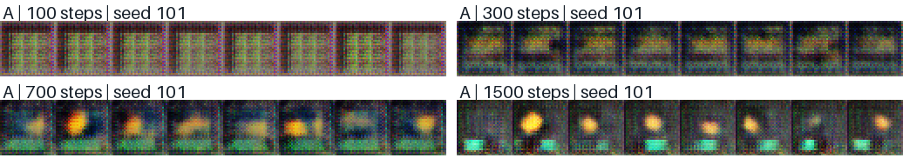
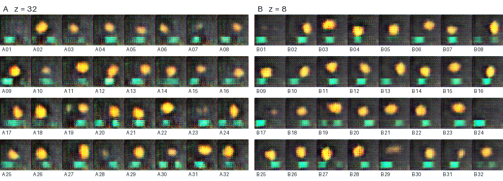
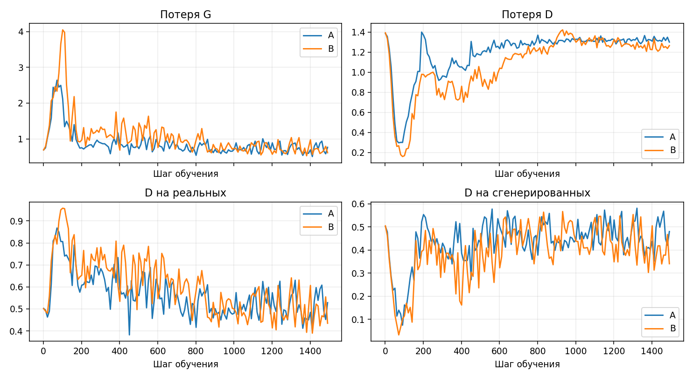

# Лабораторная работа №11. Базовая GAN

Дисциплина «Искусственный интеллект в креативных технологиях»
Студент Провков Иван Александрович, группа Т26ИИКТ-МИК11
Вариант 7
Дата прогона 25–26.11.2026

## 1. Цель и постановка

Обучить базовую генеративно-состязательную сеть на синтетических сценах и измерить, как размерность входного шума влияет на правдоподобие, охват и разнообразие образцов. Сравниваются A с `z=32` и B с `z=8`. Эксперимент включает пять одинаковых seed в двух режимах.

Гипотеза и допуски зафиксированы 25.11.2026 в 23:30 МСК до собственного запуска. Ожидаем, что при `z=8` изменения средних останутся в пределах 0,5 дБ по `nn_psnr`, 0,10 по `coverage` и 0,05 по `diversity`. На образцах ожидаем сохранения двух объектов и изменчивости положения прямоугольника. Сводка преподавателя по варианту 7 была доступна при постановке гипотезы. Подробности в [журнале](journal.md).

## 2. Данные и архитектура

Набор `disc_rect` содержит 4096 обучающих и 1024 тестовых сцен RGB 32×32. Генератор данных с seed 7 независимо задаёт x и y центра янтарного диска, его радиус и положение зелёного прямоугольника по x. Высота прямоугольника и фон фиксированы.

Генератор отображает нормальный шум в карту 64×4×4 через полносвязный слой. Три транспонированные свёртки формируют выход 3×32×32 с сигмоидой. Внутренние слои используют BatchNorm и ReLU. Дискриминатор выдаёт логит после трёх свёрток с LeakyReLU и линейного слоя. При изменении z меняется входная размерность первого слоя G.

D минимизирует сумму BCE на реальных сценах с меткой 1 и сгенерированных с меткой 0. G минимизирует BCE на сгенерированных сценах с целевой меткой 1. У каждой сети свой Adam с шагом 0,0002 и `(β₁, β₂)=(0,5; 0,999)`. На каждый шаг G приходится один шаг D. Пакет 64, обучение 1500 шагов, seed 101–105.

## 3. Среда и ход работы

Для собственного эксперимента выбран Google Colab CPU. Методичка фиксирует Engee 26.8.2-H3, Python 3.11 и PyTorch 2.4.1 на CPU. В заголовке библиотеки указан PyTorch 2.4.1+cu121. Фактические версии Python, PyTorch, NumPy, Pillow и Matplotlib, платформу, доступные CPU и число потоков PyTorch сохраняет паспорт. Фактическая среда Colab — Python 3.13.18, PyTorch 2.14.1+cpu, NumPy 2.4.6, Pillow 11.3.0, Matplotlib 3.10.0, Linux x86_64, 2 vCPU и 12,67 ГБ ОЗУ. Используются штатные пакеты Colab. Настройка `LAB_THREADS=4` задаёт четыре внутрооперационных потока, межоперационный поток один. Версии PyTorch и Python отличаются от Engee, поэтому сравнение учитывает разброс между seed. Полная фиксация среды и отпечатков кода приведена в [environment.txt](environment.txt).

[Ноутбук](../lab11.ipynb) записывает исходные библиотеки, проверяет SHA-256 и запускает серию вызовом `experiment.run(OUT, SETTINGS, SOURCE, demo=RUN_DEMO)`. Обёртка использует `train_gan`, `metrics` и `summarize` из учебной библиотеки, сохраняя отдельные журналы и снимки для каждого режима. На seed 101 сохраняет 32 образца каждого режима на шагах 100, 300, 700 и 1500. Снимки генератора снимаются копированием модели, вычисление метрик и визуализация выполняются после обучения. Это сохраняет протокол обучения и исключает диагностические расчёты из времени. Журнал содержит потери и средние оценки D через 10 шагов.

## 4. Метрики и интерпретация

- `nn_psnr` измеряет близость каждого сгенерированного изображения к ближайшему тестовому в пикселях.
- `coverage` измеряет долю тестовых сцен, для которых найдена сгенерированная сцена внутри радиуса до 20-го тестового соседа.
- `diversity` сравнивает средние попарные расстояния внутри сгенерированного и тестового наборов. Значение около 1 соответствует сопоставимому разбросу.
- `seconds` измеряет время обучения в данном сеансе.

Для каждой метрики вычисляются средние A и B, выборочное стандартное отклонение A, Δ = B−A и |Δ|/s. Срабатывание правила |Δ| > 2s оценивается отдельно от практического допуска. С контрольными значениями Engee сравниваются метрики качества, ориентиром служит 2s преподавательской серии A.

## 5. Результаты варианта 7

| Метрика | A | s(A) | B | Δ | \|Δ\|/s | Допуск | 2s | Класс |
| --- | ---: | ---: | ---: | ---: | ---: | ---: | :---: | --- |
| nn_psnr, дБ | 19,3224 | 0,4883 | 19,3253 | +0,0028 | 0,006 | 0,50 | нет | в пределах обоих |
| coverage | 0,8984 | 0,1041 | 0,8973 | −0,0012 | 0,011 | 0,10 | нет | в пределах обоих |
| diversity | 0,9499 | 0,0121 | 0,9543 | +0,0045 | 0,370 | 0,05 | нет | в пределах обоих |
| Время, с | 177,37 | 5,47 | 174,13 | −3,24 | 0,593 | — | нет | — |

| Seed | nn_psnr A / B | coverage A / B | diversity A / B | Время A / B, с |
| ---: | ---: | ---: | ---: | ---: |
| 101 | 18,863 / 19,903 | 0,832 / 0,971 | 0,952 / 0,933 | 186,3 / 172,4 |
| 102 | 19,176 / 18,874 | 0,939 / 0,809 | 0,970 / 0,997 | 172,2 / 174,3 |
| 103 | 20,048 / 18,959 | 0,994 / 0,814 | 0,944 / 0,958 | 175,5 / 175,8 |
| 104 | 19,569 / 19,242 | 0,977 / 0,920 | 0,944 / 0,927 | 174,5 / 172,7 |
| 105 | 18,957 / 19,648 | 0,750 / 0,973 | 0,939 / 0,957 | 178,3 / 175,5 |

По трём метрикам качества средние укладываются в допуски, и правило 2s не сработало. Разброс между отдельными seed намного больше итоговых разностей. По времени B быстрее в среднем на 1,83 %, что укладывается в разброс A.

### Сверка с преподавательским прогоном

| Метрика | Engee A / B | Colab минус Engee A / B | Оба режима в пределах 2s Engee |
| --- | ---: | ---: | :---: |
| nn_psnr, дБ | 19,25 / 19,23 | +0,0724 / +0,0953 | да |
| coverage | 0,882 / 0,872 | +0,0164 / +0,0253 | да |
| diversity | 0,950 / 0,952 | −0,0001 / +0,0023 | да |

Версии среды различаются, а решение по трём метрикам совпало с преподавательской серией. Сводка Engee округлена, поэтому эти расхождения оценены приблизительно. Время между платформами не сравнивалось.

## 6. Образцы и динамика обучения

На шаге 100 в A преобладают периодические полосы и сетка. К шагу 300 появляется желтоватое пятно и меняется фон. К шагу 700 различимы диски в разных местах и слабый зелёный след внизу. На шаге 1500 прямоугольники становятся более отчётливыми. Охват A на первых трёх снимках был 0,000, затем вырос до 0,832.

| Шаг A, seed 101 | nn_psnr, дБ | coverage | diversity |
| ---: | ---: | ---: | ---: |
| 100 | 13,762 | 0,000 | 0,153 |
| 300 | 16,176 | 0,000 | 0,338 |
| 700 | 16,876 | 0,000 | 0,802 |
| 1500 | 18,863 | 0,832 | 0,952 |

В финальных 32 образцах A и B у большинства сцен зелёный прямоугольник виден в нижней части и меняет положение по горизонтали. В обоих режимах встречаются слабые диски, размытые границы и шум фона. У тестовых изображений контуры чётче. На просмотренном seed уменьшение z сохранило оба объекта и вариацию композиций.

График показывает, что в начале у обоих режимов D быстро начинает различать настоящие и сгенерированные сцены. У B ранний пик потери G выше. В конце потери G колеблются около 0,7–0,8, а средние оценки D для обоих типов сцен приближаются к 0,5 и продолжают колебаться. Финальные листы A и B, промежуточные снимки A и график доступны в выходах ячейки 8 выполненного ноутбука.

### Демонстрационный вариант 1

На seed 101 для одиночного диска на шаге 1500 получено 19,572 дБ и охват 0,670 для A, а для B — 20,385 дБ и 0,710. У преподавателя те же точки дали 19,66 дБ и 0,707 для A, 20,62 дБ и 0,813 для B. Направление разности на этом seed совпало. Демо охватывает два обучения на seed 101, основной вывод опирается на пять seed варианта 7.

## 7. Диагностика

- **Один seed.** На seed 101 режим B выигрывает 1,041 дБ по nn_psnr и 0,139 по coverage. У обоих изменений превышен практический допуск. На seed 103 знак у обеих разностей противоположный, а по серии средние практически совпадают.
- **Потеря G как показатель качества.** На последних десяти замерах seed 101 средняя потеря G уменьшилась с 0,742 в A до 0,701 в B. На этом seed у B одновременно выше nn_psnr и coverage, а diversity дальше от 1. Усреднение пяти seed даёт совсем другой масштаб различий. Потеря G измеряет результат против текущего D, поэтому сама по себе не решает вопрос качества.
- **Разное число шагов.** Если взять A после 1500 шагов и B после 700, получится 18,863 против 16,923 дБ и 0,832 против 0,001 по охвату. При одинаковых 700 шагах разница 16,876 против 16,923 дБ, охват примерно нулевой в обоих случаях. Фиксированный бюджет обучения существенно меняет интерпретацию.

## 8. Ограничения

Пять seed дают ограниченную оценку разброса. Критерий 2s используется как правило методички. Пиксельные метрики чувствительны к смещениям объектов и рассчитаны для простых сцен. В режиме A охват вырос с 0,000 на шаге 700 до 0,832 на шаге 1500 и к концу обучения оставались слабые объекты. Поздний рост охвата и остаточные артефакты допускают, что 1500 шагов недостаточно для выхода на устойчивое качество. При другом бюджете обучения величина эффекта z может измениться. Разные версии вычислительных библиотек, инструкции процессора и потоковый режим могут влиять на численное совпадение между Engee и Colab.

## 9. Вывод

В данном опыте переход с 32 до 8 координат шума дал +0,0028 дБ по nn_psnr, −0,0012 по coverage и +0,0045 по diversity. Все три разности меньше заранее заданных допусков и порога 2s. Визуальная проверка на seed 101 подтвердила, что оба режима воспроизводят диск и зелёный прямоугольник. При выбранных данных и бюджете 1500 шагов наблюдения согласуются с гипотезой о достаточности восьми координат шума.

## 10. Повторение в новом сеансе Colab

Повтор начали 26.11.2026 в 14:18 МСК в новом сеансе Google Colab CPU. Python 3.13.18, PyTorch 2.14.1+cpu, 2 vCPU и 4 потока PyTorch. Обучение завершилось в 14:58 МСК. Выполнены десять обучений варианта 7 и два демо-обучения. Хеши учебных библиотек и обёртки совпали. Разность средних повторения с первым прогоном сверена с порогом 2s первого прогона. Время зависит от загрузки CPU, поэтому его сопоставление между сеансами не входит в оценку качества.

| Метрика | B−A первый прогон | B−A повтор | Повтор минус первый A / B | В пределах 2s | Класс совпал |
| --- | ---: | ---: | ---: | :---: | :---: |
| nn_psnr | +0,0028 | +0,0028 | +0,0000 / +0,0000 | да | да |
| coverage | -0,0012 | -0,0012 | +0,0000 / +0,0000 | да | да |
| diversity | +0,0045 | +0,0045 | +0,0000 / +0,0000 | да | да |

Все три метрики качества совпали для каждой из десяти пар «режим и seed» с сохранённой точностью. Классы по 2s и практическим допускам совпали. Среднее время A и B в повторном сеансе составило 203,12 и 199,07 с, разность укладывается в 2s повторного сеанса.

## 11. Паспорт и материалы

| Поле паспорта | Значение |
| --- | --- |
| Первый сеанс, МСК | 25.11.2026 23:52 — 26.11.2026 00:27 |
| Повторный сеанс, МСК | 26.11.2026 14:18–14:58 |
| Среда обоих сеансов | Google Colab CPU, Linux x86_64, 2 vCPU, 12,67 ГБ ОЗУ |
| Версии пакетов | Python 3.13.18, PyTorch 2.14.1+cpu, NumPy 2.4.6, Pillow 11.3.0, Matplotlib 3.10.0 |
| Потоки PyTorch | 4 внутрооперационных, 1 межоперационный |
| Набор и выборки | disc_rect, RGB 32×32, 4096 обучающих и 1024 тестовых сцен |
| Конфигурации A и B | A z=32, B z=8. Ширина G=1, BatchNorm, ненасыщающая потеря |
| Общие параметры обучения | Adam, lr G=D=0,0002, β₁=0,5, β₂=0,999, пакет 64, 1500 шагов, 1 шаг D на шаг G |
| Seed и оценка | Seed обучения 101–105, seed набора 7, seed листов 7. 1024 образца G, k=20 для охвата |

[Архив повторного прогона](../artifacts/lr11_repeat.zip) сохранён как `artifacts/lr11_repeat.zip`. Он включает паспорт, журналы всех 12 обучений, метрики, листы, график и визуальную проверку. Машиночитаемый [паспорт повтора](../artifacts/repeat_session/passport.json) содержит точные параметры запуска. Итоги сверки сохранены в [repeat_check.json](../artifacts/repeat_session/repeat_check.json). Фактические версии, контрольные суммы и время запуска приведены в [файле среды](environment.txt).

Локальный [ноутбук](../lab11.ipynb) содержит выходы, восстановленные из проверенного ZIP. История выполнения сохранена в [первом ноутбуке Colab](https://colab.research.google.com/drive/1ZH67calfZqfAlxTfbBTGIPoqfkmo-YbR) и [ноутбуке повторения](https://colab.research.google.com/drive/10lnT8sTzH8ta6fUyEaY5nq13s38d1IUb).
